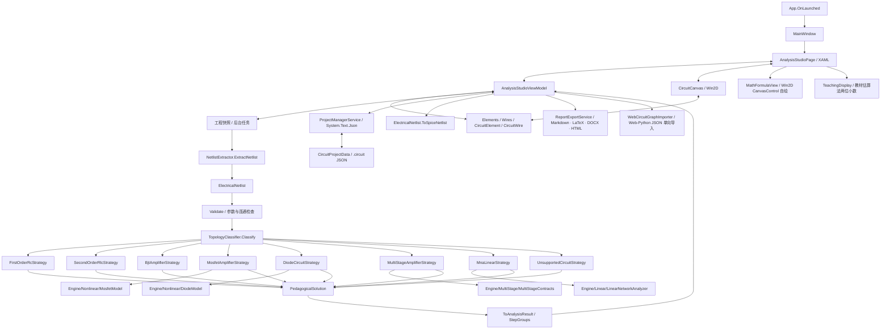

# CircuitAssistant 当前技术架构与接口

> 基线：2026-10-19 当前工作区（耗尽型 MOS/JFET 教学求解与元器件工作区物理核验修订后，包括未提交改动；阶段版本 0.2.0-preview.1）。本文描述当前实现；原始验收要求见 [ORIGINAL_REQUEST.md](ORIGINAL_REQUEST.md)，需求目标不等同于已完成能力。

> 第二轮已完成 MNA 2.0 通用线性网络求解、分步分析报告导出（LaTeX/Circuitikz、Word、Markdown、HTML）、Web/Python CircuitGraph 单向导入与本地 30 题基准工程；第三轮（2026-10-18）新增 PNP 教学分析、硅/锗管压降参数、按国际标准统一的元件符号矢量库与参数语义标注；第五轮完成 PNP 默认朝向与 ALT+X 镜像。**第六轮（2026-10-18）新增二极管非线性教学求解（9 类子类型）、MOSFET 平方律教学求解（共源/共漏/共栅，NMOS/PMOS）、BJT 共集电极、多级放大预留接口与明确拒绝，并生成 29 个原生 `.circuit` 教学电路文件；MOS 的 K/λ 已持久化（检查器编辑框与 JFET IDSS 于 2026-10-19 补齐）。第七轮（2026-10-18）把显示层统一为教材估算法（每步两位小数舍入并回代、删除戴维南双口径并列、后端 `Exact*` 仅保留）、把结果显示两位小数推广到全部题型、为 BJT/MOS 推导加入 DC/AC 等效电路分组（`SolutionPhase`/`StepGroups`），并用 Win2D 自绘公式框（真角标/分式/根号/矩阵/自动换行，基础字号 16）替换 Unicode 文本转写。第八轮（2026-10-18）BJT 策略支持信号源内阻 Rs 与电解输入耦合电容（Aus=Av·Ri/(Rs+Ri)、τ1=(Rs+Ri)C1、未覆盖电阻诊断文案），修复保存工程时把 ProjectName 改写为文件名的缺陷，B07 教学变体可解、M2 回归扩充。第九轮（2026-10-18）BJT 小信号参数 r_bb' 与 r_be(h_ie) 可编辑并持久化（0=自动；给定 r_be 直接采用），共射四类偏置/共基/共集全部读取实际参数，检查器与参数设置两处编辑框；本轮按用户要求不做 ui-capture 窗口验收。2026-10-19 补全耗尽型 NMOS/PMOS 与 N/P 沟道 JFET 单管教学求解（Shockley 方程、MOS K/λ 与 JFET IDSS 检查器可编辑并随工程持久化），并完成元器件工作区物理核验修订（BJT 无 Re 加载偏置方程、BE/BC 结条件统一校验、MOS/JFET 分段模型+直流负载线、二极管/FET 非有限值归 Invalid）；阶段版本 0.2.0-preview.1 发布前实测全量控制台回归 20 组 / 4905 项断言通过（M2SolverChallenger 166/166、NonlinearCircuitChecks 1606/1606 等）。** 多级级联求解与 NPN+PNP 混合非线性网络分析仍列入后续规划。能力边界与实测结果见[耗尽 MOS/JFET 实现记录](projects/fet-depletion-jfet-strategies-20261019.md)、[工作区校验修订](projects/operating-region-validation-20261019.md)、[第九轮修订记录](projects/technical-code-fixes-20261018-round9.md)、[第八轮修订记录](projects/technical-code-fixes-20261018-round8.md)、[第七轮修订记录](projects/technical-code-fixes-20261018-round7.md)、[第六轮修订记录](projects/technical-code-fixes-20261018-round6.md)、[第二轮修订记录](projects/technical-code-fixes-20261017-round2.md)、[第三轮修订记录](projects/technical-code-fixes-20261018-round3.md)与[第二轮审查报告](projects/technical-document-review-20261017-round2.md)。视觉部分仍安排在后续阶段开发，当前先完成软件本体；详见[修订记录](projects/technical-code-fixes-20261017.md)。

## 1. 架构与执行路径



原生主链路没有 HTML 页面、浏览器 DOM、React Flow、HTTP 轮询、SQLite 队列或 Python 子进程。`MainWindow` 直接导航至 `AnalysisStudioPage`；其他样例/设置/符号页源码存在，但不构成当前主窗口导航系统。

启动时集合为空，HasActiveProject=false，结果为未求解。新建/打开工程后激活工作台；ResetToDefaults 只重置模板参数，保留布局；不再生成固定共射预览。

一次求解的执行顺序：编辑集合快照 → `NetlistExtractor` → `Validate` → `TopologyClassifier` → 专用教学策略（RC/RL、RLC、单管 BJT 共射/共基/共集、单管增强/耗尽型 MOSFET 与 N/P 沟道 JFET、二极管电路、多级明确拒绝）；若专用策略明确拒绝而网络只含线性元件（且不是多级/二极管/MOS 教学电路），`AnalysisStudioViewModel` 会回退到 `MnaLinearStrategy`（MNA 2.0，直流稳态/交流相量），并在摘要中注明回退原因。晶体管总数 >1（含 BJT+MOS 混合）分类为 `MultiStageAmplifier/"Cascade"`，由 `MultiStageAmplifierStrategy` 明确拒绝，不会用第一只管子套用单管公式。求解使用协作式取消令牌，取消等待后不再发布迟到结果。

报告与导入都是进程内能力：报告由 `Services/ReportExportService.cs` 从最近一次求解的 `ElectricalNetlist` + `PedagogicalSolution` 纯内存生成四种格式后写入用户选择的位置；`Services/WebCircuitGraphImporter.cs` 把 Web/Python `CircuitGraph` JSON 单向转换为原生 `CircuitProjectData`（自动布局 + 单位换算），再走正常编辑/求解流程。当前没有把原生工程导出为 Web 格式的双向适配器。

## 2. 组件职责

| 模块 | 关键源码 | 职责 |
|---|---|---|
| 生命周期 | `apps/desktop-winui/App.xaml.cs` | 创建窗口、注册 HWND 提供器、调度器、写入应用目录 `startup.log`；异常记录后仍允许失败传播 |
| 主窗体 | `MainWindow.xaml/.cs` | Mica、标题栏、图标、Frame 导航 |
| 工作台 | `Views/AnalysisStudioPage.xaml/.cs` | XAML 绑定、文件和求解快捷键、控件事件接线；实时指标卡在识别到信号源内阻 Rs 时显示"信号源内阻 Rs/源电压增益 Aus"两行；选中 BJT 时元件参数检查器显示 r_bb'/r_be(h_ie) 编辑框，选中 MOS/JFET 时显示 K/λ（MOS）与 IDSS（JFET）编辑框，"参数设置 → 三极管模型与信号源特性"Group 3 另有一组宏参数编辑框 |
| 编辑状态 | `ViewModels/AnalysisStudioViewModel.cs` | 元件/导线集合、筛选、选中状态、模板、快照历史、求解与 MNA 回退、最近解缓存、报告导出命令、工程命令；保存时保留工程标题（仅"未命名电路工程"回退文件名）；`RbbNumber`/`RbeNumber` 宏参数与 BJT 元件双向同步 |
| 原理图 | `Controls/CircuitCanvas.xaml/.cs` | Win2D 绘制、命中、拖拽、布线、线段与分支交互 |
| 符号预览 | `Controls/CircuitSymbolPreview.xaml/.cs` | 原生矢量符号卡片，不通过 HTML/SVG DOM |
| 数据 | `Models/CircuitElement.cs` | 元件、引脚、导线、正交路径、引脚变换和克隆；半导体材料（硅/锗）与参数语义（β/Vth/VGS(off)/VF）；`MirrorX` 镜像与统一旋转/镜像矩阵；BJT 小信号参数 `BjtRbb`（Ω，0=自动）、`BjtRbe`（Ω，0=按 Q 点计算）与 `SupportsBjtSmallSignalParameters`/显示辅助 |
| 变换同步 | `Models/CircuitWireSync.cs` | 元件旋转/镜像后统一重算直连导线端点、`WireTap` 分支节点与二级传播；画布和 ViewModel 共用 |
| 符号几何 | `Models/SymbolGeometry.cs` | 纯 C# 矢量符号几何：画布与符号库卡片共用同一套标准图元（NPN/PNP、JFET、MOSFET、VCC、GND、二极管、电源、受控源等） |
| 工程格式 | `Models/CircuitProjectData.cs` | 可序列化 DTO，`From/ToModel` 转换；当前版本 1.2.0（兼容 1.0.0/1.1.0）；元件 DTO 新增 `BjtRbb`/`BjtRbe`（缺省 0=自动，负数/非有限值拒绝）与 `MosfetK`/`MosfetLambda`/`JfetIdss`（JFET 的 IDSS 缺省 0=未填，求解时要求有限正数；负数/非有限值拒绝） |
| 文件服务 | `Services/ProjectManagerService.cs` | WinRT 文件选择器、JSON 读写、SPICE/报告保存、Web JSON 探测 |
| 原型格式导入 | `Services/WebCircuitGraphImporter.cs` | Web/Python `CircuitGraph`（benchmark 包装或裸图）→ 原生 DTO：definitionId/端口映射、SI→工程单位、确定性自动布局、未知定义报错 |
| 报告导出 | `Services/ReportExportService.cs` | 纯内存生成 Markdown / LaTeX+Circuitikz / Word `.docx`（手写 OOXML）/ 自包含 HTML；四种格式共享同一报告模型；AC 参数表在识别到 Rs 时含"信号源内阻 Rs/源电压增益 Aus（含 Rs）"两行 |
| 模板 | `Services/CircuitTemplateFactory.cs` | 空白及四种教学模板的声明式元件/导线 |
| 电气引擎 | `Engine/` | 网表、拓扑分类、单管 BJT/二极管/MOSFET/JFET/多级预留教学策略、一阶/二阶策略、不支持策略、教学结果转换（`SolutionPhase`/`StepGroups` 分组）；BJT 策略支持信号源内阻 Rs/电解耦合电容识别与 `Aus`；BJT 小信号参数从元件读取（`BjtRbb`/`BjtRbe`，0=自动），rbe/hie 步骤不再硬编码 200/50 Ω；MOS/JFET 策略读取 K/λ/IDSS，按增强/耗尽 MOS 与 JFET 分别使用平方律或 Shockley 方程 |
| 非线性器件模型 | `Engine/Nonlinear/DiodeModel.cs`、`Engine/Nonlinear/MosfetModel.cs` | 二极管恒压降分段线性 + Shockley/Newton 模型（指数钳位）；MOSFET Level-1 平方律（Vth/K/λ，NMOS/PMOS 增强/耗尽镜像量、区域判定、gm/gds）与 JFET Shockley 方程（IDSS/VGS(off)、K=IDSS/VGS(off)²、栅结正偏校验） |
| 多级预留接口 | `Engine/MultiStage/MultiStageContracts.cs` | `IMultiStageAnalysis.TryPlan`、`MultiStagePlan`/`MultiStageStage`；当前只预留接口，级联求解未实现 |
| 教学结果显示 | `Engine/PedagogicalSolution.cs`、`Services/TeachingDisplay.cs`、`Models/AnalysisResult.cs` | 教材估算法（显示单位两位小数舍入 + 显示值回代）、`SolutionPhase`/`SolutionPhaseInfo`/`Step.Phase`，`ToAnalysisResult()` 生成 `AnalysisStepGroup`（DC/AC 分组，无相位策略单一无标题组）；`AcParametersInfo.HasSourceResistance/SourceResistance/SourceVoltageGain`（识别到 Rs 时由 UI/报告显示，不序列化） |
| 数学排版引擎 | 仓库根 `apps/desktop-winui/Math/*`（`MathNode`/`MathLatexParser`/`MathLayoutEngine`/`IMathTextMeasurer`/`EstimateMathTextMeasurer`） | 纯 C# LaTeX 子集解析与二维布局：真角标、叠放分式、根号、矩阵/cases/array、自动换行、超宽原子等比缩小；控制台可测 |
| 电路模型生成器 | `tools/CircuitModels.Core` 与 `tools/CircuitModels.{Diode,BjtBias,BjtAmp,Mos}` | 声明式电路规格 DSL、正交布线、与应用一致的 JSON 序列化、结构自检与分类/求解预期校验；生成 `examples/circuit-models/` 的 29 个 `.circuit` 文件 |
| 线性网络分析 | `Engine/Linear/LinearNetworkAnalyzer.cs` | 复数 MNA 2.0：R/C/L、独立电压/电流源、四种受控源；DC 稳态与 AC 相量、任意端口 Req/戴维南、10 Hz–10 MHz 扫频与 −3 dB 截止估计、结构化结果与失败原因 |
| 数学展示 | `Controls/MathFormulaView.xaml/.cs` | Win2D `CanvasControl` 自绘公式（按宽度换行、内容自适应高度、基础字号 16、主题色、CJK 回退），复制原始 LaTeX |
| 数字格式 | `Services/ScientificNotationFormatter.cs`、`Services/TeachingDisplay.cs` | 科学计数法/SI 前缀文本格式化（默认两位小数）与教材式显示单位、两位小数舍入及回代值 |

以上主项目内部路径均相对于 `apps/desktop-winui/`，表中已写完整前缀的除外。MVVM 使用生成属性和命令，但控件仍承担较多编辑行为、页面仍有事件处理，不能称为界面与业务“完全解耦”。

## 3. 数据与接口契约

### 编辑模型与文件

- `ObservableCollection<CircuitElement> Elements`、`ObservableCollection<CircuitWire> Wires` 是当前编辑状态。
- `CircuitElement` 保存类型、标识、显示数值、单位、中心坐标、大小、旋转、**水平镜像（`MirrorX`，ALT+X）**、引脚；另有 `Material`（半导体材料：硅/锗）与派生的 `ForwardVoltageDrop`（硅 0.7 V / 锗 0.3 V，用于二极管 VF 与 BJT |VBE|）、`MosfetK`（平方律参数 K，A/V²，默认 1 mA/V²）与 `MosfetLambda`（沟道长度调制 λ，1/V，默认 0）、`JfetIdss`（JFET 饱和漏极电流 IDSS，A，默认 0=未填，求解前须补填有限正数）、`BjtRbb`（BJT 基区体电阻 r_bb'，Ω，默认 0=自动：共射/共集 200 Ω、共基 50 Ω）与 `BjtRbe`（BJT 给定 r_be=h_ie，Ω，默认 0=按 Q 点计算）、`ParameterLabel/ParameterDescription/FormattedParameterDisplay`（参数含义与标签）。原生符号清单由 ViewModel 初始化，当前 25 项。
- `CircuitWire` 保存两端坐标、元件/引脚或父导线引用、`NetId`、`FlipCorner`、`CustomMid`、`Waypoints`。
- WireTap 端的 `StartPinName/EndPinName="WireTap"`，对应 ElementId 保存父导线 ID；普通端保存元件和引脚 ID。
- 纯母线端可为空或使用 `None`；不是每根导线两端都必须绑定元件。
- `CircuitProjectData` 的新版本为 `1.2.0`（读取兼容 `1.0.0`/`1.1.0`，旧文件缺省硅管材料，缺省未镜像），由 `System.Text.Json` 保存；不使用 Zod 生成 C# 类。Web/Python `CircuitGraph` 只在打开时由 `WebCircuitGraphImporter` 单向转换为原生 DTO，没有通用双向 `CircuitGraph` 适配层或自动 Schema 镜像。元件 DTO 新增半导体材料字段、可选 `MirrorX` 字段、`MosfetK`/`MosfetLambda`/`JfetIdss` 字段与 `BjtRbb`/`BjtRbe`（旧版软件读取时忽略新字段，旧文件缺省 K=1 mA/V²、λ=0、JfetIdss=0（求解前须补填）、BjtRbb/BjtRbe=0=自动；MOS 的 K 必须为有限正数、λ 为有限非负数，JFET 的 IDSS 为有限非负数（0=尚未填写，求解时要求正数），负数/非有限值在 `Validate()` 拒绝）；读取旧 PNP 工程时按新的“发射极在上”默认布局迁移引脚并重挂导线。`examples/circuit-models/` 的 29 个教学文件就是该格式的原生工程，可直接由“打开工程”加载。
- **保存语义（第八轮修复）**：保存工程时保留工程标题 `ProjectName`（仅“未命名电路工程”/空标题回退到文件名），`ProjectFileName` 仍更新为当前保存文件名；旧行为每次保存强制 `ProjectName=文件名`，会改写教材示例标题并导致生成器 `--verify` 工程名校验失败。教材工程（B07/D06）的标题已在工作区恢复。

完整字段、引脚和单位规则见[数据层报告](projects/data-layer-technical-report.md)。

### 网表提取与分类

```csharp
ElectricalNetlist NetlistExtractor.ExtractNetlist(
    IEnumerable<CircuitElement> elements,
    IEnumerable<CircuitWire> wires);
ElectricalNetlist NetlistExtractor.Extract(
    IEnumerable<CircuitElement> elements,
    IEnumerable<CircuitWire> wires); // 别名

ClassificationResult TopologyClassifier.Classify(ElectricalNetlist netlist);
CircuitTopologyType TopologyClassifier.Classify(
    ElectricalNetlist netlist, out ICircuitStrategy strategy);
```

网表使用并查集结合显式端点、WireTap、带约束的几何贴合；`SnapTolerance=8`、`SegmentTapTolerance=5`。编号 0 用作参考地；缺地时可自动选参考网络。`ExtractNetlist` 会回写引脚和导线 NetId，不是无副作用的纯函数。

```csharp
public interface ICircuitStrategy
{
    CircuitTopologyType TopologyType { get; }
    string SubtypeName { get; }
    Task<PedagogicalSolution> SolveAsync(
        ElectricalNetlist netlist,
        AnalysisParameters parameters,
        CancellationToken cancellationToken = default);
}
```

分类优先级（第六轮契约）：空网表 → `Unsupported/Empty`；**晶体管总数（BJT + MOSFET/JFET）> 1（含混合）→ `MultiStageAmplifier/"Cascade"`**（`MultiStageAmplifierStrategy`，明确拒绝）；**单只 BJT → `BjtAmplifier`**，子类型顺序 `CommonBase` → `CommonCollector`（新增）→ 现有三类偏置；**单只 MOSFET/JFET → `MosfetAmplifier`**（子类型由 `MosfetAmplifierStrategy.DetectSubtype` 识别；增强/耗尽 MOS 与 N/P JFET 均进入教学求解，JFET 栅结正偏或 IDSS 缺失/非正数时明确拒绝并点名器件）；**无晶体管且有二极管 → `DiodeCircuit`**（子类型由 `DiodeCircuitStrategy.DetectSubtype` 识别）；其余沿用单储能 RC/RL → 一 L 一 C 的 RLC → 通用 MNA；空网络为 `Unsupported`。分类主要依赖元件种类、数量和有限连通启发式，不能验证任意拓扑是否适用。专用策略拒绝的**纯线性**网络可在工作台回退到 `MnaLinearStrategy`；`MnaLinearStrategy`/`LinearNetworkAnalyzer` 自身对二极管/MOS/BJT/变压器/VccPort 的拒绝行为保持不变。

### 线性网络分析接口

`Engine/Linear/LinearNetworkAnalyzer.cs` 提供独立于编辑模型的复数 MNA 2.0：

```csharp
LinearNetworkAnalyzer.TryCreate(ElectricalNetlist netlist, out var model, out var error, CancellationToken ct);
LinearNetworkAnalyzer.TrySolveDc(...);                       // C 开路、L 0V 短路
LinearNetworkAnalyzer.TrySolveAc(double frequencyHz, ...);   // C=jωC、L=jωL，DC 源置零
LinearNetworkAnalyzer.TryGetEquivalentResistance(netA, netB, ...); // 独立源置零 + 1A 测试电流
LinearNetworkAnalyzer.TryGetThevenin(netA, netB, ...);       // DC 开路电压 + Req
LinearNetworkAnalyzer.TrySweep(inPos, inNeg, outPos, outNeg, fStart, fStop, pointsPerDecade, ...);
```

- 支持器件：R、C/电解电容、L、独立 DC/AC 电压源与电流源、VCVS/VCCS/CCVS/CCCS、Ground。四种受控源的符号/方向约定写在分析器文件头注释中（VCVS/VCCS 为电压控制；CCVS/CCCS 控制端为 0V 支路电流）。
- 拒绝器件：二极管、变压器、BJT、全部 MOSFET/JFET、VccPort（错误信息列出器件 ID）；非线性、互感、运放不在范围内。
- 求解：行均衡 + 部分选主元复高斯消元，回代后做相对残差复核；奇异/病态/非有限返回失败原因；矩阵变量上限 256；所有建网/求解/扫频循环响应 `CancellationToken`。
- 任意端口等效：`Req` 为独立源置零后的端口等效电阻（可能为 +∞，表示无直流通路）；`Voc` 为独立源保留时的 DC 开路电压；AC-only 网络可能没有 DC 解。
- 频响：10 Hz–10 MHz、每十倍频程 10 点（固定 61 点），−3 dB 截止用对数插值估计；输出端口为启发式（排除激励端口后取相量幅值最大的非地节点），不确定时写 `BoundaryNote`。截止不可测（窗口未覆盖交叉点或窗口完全处于阻带）时三个截止/带宽字段为 null、Display 为“未检测到（超出扫描范围）”，不输出伪值。DC 与 AC 的激励源端口一致采用电压源优先、同类按元件 Id 确定性排序。

### 结果

`PedagogicalSolution` 保存成功标志、拓扑/子类型、摘要、步骤、可选 Q 点与交流参数、日志，以及可选的 `LinearNetwork`（`Models/LinearAnalysisModels.cs` 中的结构化契约）。`LinearNetworkInfo` 包含：

- `ModelSummary/OperatingMode/MatrixDimension`；
- `NodePotentials`（每个非地网电位，DC 为伏特；AC 为峰值幅值，Display 含相位）；
- `PortEquivalents`（任意端口 `Req`、`Voc`，最多 14 条，超出在 `BoundaryNote` 说明）；
- `FrequencyResponse`（输入/输出端口标签、工作频率增益/相位、截止/带宽、全部扫频点与边界说明）；
- `BoundaryNote`（未知增益单位、截断、∞ Req、无 AC 激励、截止未检出、适用范围等）。

步骤包含公式、代入式、文字解释、结果、状态和 Values。`ToAnalysisResult()` 转为 UI 模型（含节点电位、端口等效、扫频频点集合与频响摘要）；部分策略内部字段（如步骤 Status/Values）不会完整映射到 UI 模型。**结果容器新增两类 UI 派生结构（不随工程文件持久化）**：`QPointInfo.ExactIbq/ExactIcq/ExactVceq`（后端戴维南精确值，诊断/测试/报告内部用，UI 不绑定）与 `AnalysisResult.StepGroups`（按 `SolutionPhase` 把步骤分成 DC/AC 等效电路组；无相位的策略只有单一无标题组）。二极管/MOSFET/JFET/共集教学策略按各自契约填充结果：二极管电路 `QPoint` 标记“二极管非线性电路”（`Ibq/Icq/Vceq="—"`）且 `AcParameters` 为 null，关键量写入摘要与推导步骤；MOSFET/JFET `Ibq="—"`、`Icq=ID`、`Vceq=VDS`、工作区标饱和区（可变电阻区只报告分区并停止 AC 推导），`AcParameters` 填 Av/Ri/Ro；共集电极正常填 QPoint 与中频 Av/Ri/Ro。BJT/MOSFET/JFET 的**显示**统一为教材估算法：分压偏置先算空载 `U_B`，再 `I_EQ→I_BQ→I_CQ→U_CEQ`，每个显示值按显示单位最多两位小数（AwayFromZero）舍入后代入下一步；公式保留全部项（`(1+β)` 等），不做代数化简。不再输出“戴维南精确 vs 教材估算”并列文案；题3-12 场景显示链为 `U_B=11.63 V → I_EQ=53.85 μA → I_BQ=0.53 μA → I_CQ=53 μA → U_ECQ=11.82 V`，后端精确值 `IBQ=0.487767 μA`、`ICQ=0.0487767 mA`、`U_ECQ=11.8384 V` 仅保留在 `Exact*`/第 1 步 `Values`。若教材估算法把工作点算进饱和区（如“软分压器”），策略明确拒绝，不显示后端精确值。全部教学题型（BJT/MOS + RC/RL/RLC/MNA/二极管）与报告的显示数值最多两位小数。**BJT 放大器另支持信号源内阻 Rs 与电解输入耦合电容（第八轮）**：识别 `交流源→Rs（源与输入耦合电容之间恰一只电阻）→输入耦合电容→基极/发射极` 的教学拓扑，电解电容按 `+/-` 引脚取网并在 DC 相追加极性核验；识别到 Rs 时 `AcParametersInfo.HasSourceResistance=true`，`SourceResistance`/`SourceVoltageGain` 由实时指标卡与报告导出显示两行（"信号源内阻 Rs""源电压增益 Aus"），Aus 用显示舍入后的 `Av·Ri/(Rs+Ri)`（共基 `Au·ri'/(Rs+ri')`），fL 输入时间常数为 `(Rs+Ri)·C1`；未覆盖电阻的失败文案列出元件 Id/两端网名与支持位置。无 Rs 时这些字段为默认隐藏、输出与第七轮一致。**BJT 小信号参数（第九轮）**：元件 `BjtRbb`（Ω，0=自动）与 `BjtRbe`（Ω，0=按 Q 点计算；>0 题目给定）随工程持久化；引擎对共射四类偏置/共基/共集、NPN/PNP 读取 `rbb = BjtRbb>0 ? BjtRbb : (CommonBase?50:200)` 与 `rbeGiven = BjtRbe>0`，computed 仍按教材链 `r_be=RoundResistance(rbb+(1+β)U_T/I_EQ)` 并回代，given 直接采用原值参与 Av/Ri/Ro/fL 推导（不再二次舍入）；rbe/hie 步骤文案/公式/代入使用实际 rbb 值；第 2 步（共基为 h_ie 步）`Values` 新增稳定键 `rbb_ohm`/`rbe_ohm`/`rbe_source`（`computed`|`given`），共基保留 `hie`。后端非法值（非有限/负数）明确失败且文案含"必须为有限非负数"，不输出 Q 点/交流参数/步骤。**本轮（第九轮）按用户要求不做 ui-capture 窗口验收**，仅控制台回归 + 构建。

`AnalysisParameters` 的频率、温度与包含暂态/频响开关已经定义，但策略并不全部使用；策略仍主要同步执行；工作台将其放入快照后台任务，设 15 秒等待上限并允许取消等待。第二轮已把 `CancellationToken` 传入全部策略与 MNA 2.0 循环，取消/超时不会发布迟到结果；这仍是协作式取消，不是进程级强制终止。

### 报告与导入契约

- `Services/ReportExportService.cs` 的输入是 `AnalysisReportContent { ProjectName, ProjectFilePath, GeneratedAt, ElectricalNetlist Netlist, PedagogicalSolution Solution }`，输出 Markdown 字符串、LaTeX 字符串、`.docx` 字节数组或 HTML 字符串；服务不写文件、不弹选择器。PDF 不是导出格式（HTML 可由浏览器打印，LaTeX 可由 xelatex 编译）。
- `Services/WebCircuitGraphImporter.cs` 的输入是 Web/Python `CircuitGraph` JSON（benchmark 包装或裸图），输出 `CircuitProjectData`。原图中没有几何坐标，导入器用确定性网格自动布局；每个 connection 生成一根导线，由网表提取器的几何端点合并还原节点。未知 definitionId / 端口 / 必需参数汇总后抛出 `InvalidDataException`。当前只有单向导入，没有原生→Web 导出。

## 4. 支持矩阵与实现边界

| 分类 | 当前实现 | 限制 |
|---|---|---|
| RC/RL | 标准串联回路、时间常数、零初值、RC 高/低通与归一化 RL 电流 | 先检查单闭合串联回路；并联、加载和多源明确不支持（可回退 MNA 稳态分析） |
| RLC | 各一个 R/L/C 的标准串/并联、阻尼、根、带宽与半功率频率 | 检查支路结构，拒绝复杂二阶网络；时域为未定系数通式（可回退 MNA 相量分析） |
| BJT | 单只 NPN **或 PNP** 的分压、固定、集电极反馈、共基极与**共集电极（射极跟随器）**教学计算；硅管 VBE/VEB≈0.7 V、锗管≈0.3 V 可选；**支持信号源内阻 Rs**（源与输入耦合电容之间恰一只电阻的教材拓扑）与**电解输入耦合电容**（`+/-` 引脚识别、DC 相极性核验），识别到 Rs 时给出 `Aus=Av·Ri/(Rs+Ri)` 并显示 Rs/Aus 两行；**小信号参数 r_bb'/r_be(h_ie) 可调**（`BjtRbb`/`BjtRbe`，0=自动；题目给定 r_be 直接采用，rbe/hie 步骤不再硬编码 200/50 Ω；第 2 步 Values 含 `rbb_ohm`/`rbe_ohm`/`rbe_source`）；显示采用**教材估算法**（每步两位小数舍入并回代，未舍入加载解用于工作区核验，后端精确值保留在 `QPointInfo.Exact*`/Values；无 Re 或空载估算失效时切换含负载偏置方程，仍按教学舍入显示）；推导按 DC/AC 等效电路分组 | 不补缺失器件或强制教材固定答案；多级、NPN+PNP 混合、真实非放大区明确拒绝，数值失败单独诊断；工作区校验包含集电结不正偏条件，部分高频为模型估算；Rs 只识别"源与输入耦合电容之间恰一只电阻"，串联多只/复杂源网络明确失败并给出诊断；给定 r_be 原值不二次舍入（与 computed 显示值回代语义不同，属有意设计）；rbb/rbe 为每只 BJT 元件参数；含二极管等非线性器件的单 BJT 网络仍由 BJT 策略明确拒绝 |
| 教学结果显示规范 | 全部题型显示数值最多两位小数（AwayFromZero）；BJT/MOS 显示值为教材估算法手算链（显示值回代；题目给定 r_be 为原值直接采用，不二次舍入）；BJT/MOS 步骤按 `SolutionPhase` 分为“直流等效电路（DC）→交流等效电路（AC）”两组（`AnalysisResult.StepGroups`）；无相位的 RC/RL/RLC/MNA/二极管保持平铺；BJT 识别到 Rs 时 `AcParametersInfo` 含 `HasSourceResistance/SourceResistance/SourceVoltageGain` 并由 UI/报告显示；BJT 小信号参数步骤 `Values` 含 `rbb_ohm`/`rbe_ohm`/`rbe_source` | 显示舍入不等于计算精度损失，后端数值与显示文本可能不同；`Exact*`/`StepGroups`/Rs/Aus 字段不序列化；窗口内像素级显示未验收 |
| 公式排版 | `Math/` 纯 C# 解析+二维布局 + `MathFormulaView` Win2D `CanvasControl` 自绘：真上下角标（0.72×）、叠放分式、根号、bmatrix/pmatrix/cases/array、希腊字母、`\mathbf`、CJK 回退、按宽度自动换行、内容自适应高度、基础字号 16、复制 LaTeX | array 列格式竖线不画；单一超宽原子整体等比缩小；Canvas 文本不可选择；`\overline/\vec/\tilde` 只保留内容不画装饰；不是 KaTeX/MathML/完整 TeX；真实字形与换行像素未做窗口验收 |
| 二极管非线性电路 | 恒压降分段线性模型 + Shockley/Newton 直流工作点：半波/桥式整流、电容滤波、串联/双向限幅、钳位、峰值检波、二极管直流偏置（`DiodeCircuit` 9 类子类型）；Si/Ge 压降可选 | 大信号波形用**教材解析公式**而非 SPICE 瞬态；直流偏置只支持源—电阻—二极管单一串联回路（并联/分支明确拒绝）；不覆盖非教材拓扑；纹波等为近似公式 |
| MOSFET/JFET | 单只增强/耗尽型 NMOS/PMOS 与 N/P 沟道 JFET 的共源、共源+Rs、共源旁路、共漏、共栅教学计算：VG/VGS/ID/VDS、饱和区校验、gm/ro、Av/Ri/Ro；增强/耗尽 MOS 用 Level-1 平方律，JFET 用 Shockley 方程 `ID=IDSS·(1−VGS/VGS(off))²`（K=IDSS/VGS(off)²）；K/λ/IDSS 可在检查器编辑并随工程持久化；显示为教材估算法（直流 3 步/交流 4 步，共 7 步，DC/AC 分组） | 忽略体效应/亚阈值/迁移率退化；JFET 栅结正偏、IDSS 缺失/非正数明确失败；可变电阻（三极管）区只报告分区并停止 AC 推导，不输出伪增益；**MOSFET/JFET 放大器暂不支持信号源内阻 Rs/Aus（第八轮范围仅 BJT）** |
| 多级放大 | 晶体管总数 >1（含 BJT+MOS 混合）分类为 `MultiStageAmplifier/"Cascade"`，`MultiStageAmplifierStrategy` 明确拒绝并说明后续规划；预留 `IMultiStageAnalysis` 接口 | **级联求解未实现**；当前不把第一只管子套用单管公式；B12–B14 文件可打开/可编辑但不会求解 |
| 通用线性 MNA 2.0 | R/C/L、独立 DC/AC 电压/电流源、VCVS/VCCS/CCVS/CCCS 的 DC 与 AC 相量求解；任意端口 Req/戴维南；10 Hz–10 MHz 扫频与截止估计 | 最多 256 个矩阵变量；仅线性；不含非线性/互感/运放；输出端口为启发式；AC 源按峰值幅值实数相量，不做瞬态；对二极管/MOS/BJT 的直接拒绝行为未变 |
| MOS/JFET 符号与参数 | 可编辑符号、类型识别；参数语义明确为阈值电压 Vth（增强型 MOS）/夹断电压 VGS(off)（耗尽型 MOS/JFET）；MOS 保存并可编辑 K/λ，JFET 保存并可编辑 IDSS；元素字段随工程保存/读回 | JFET/耗尽型 MOS 均可教学求解（单管五类拓扑）；JFET 必须填有限正数 IDSS，栅结正偏明确拒绝；求解范围不扩展到多管/混合网络 |
| 元件符号 | `Models/SymbolGeometry.cs` 统一标准矢量符号：NPN 默认集电极在上/发射极在下，PNP 默认**发射极在上/集电极在下**、发射极实心箭头向内；N-JFET/P-JFET 按 IEC 60617（无独立栅极条、栅极箭头直指/背离沟道、D/S 经水平横线接沟道）、四类 MOSFET 区分增强/耗尽与 N/P（栅极板与沟道分离、D/S 横线接沟道段中点、衬底箭头与源极短接并带连接点）、电解电容负极曲板凸向正极板、VCC 采用 Multisim 风格电源横杠、GND 为 IEC 三横线、二极管/电源/受控源/无源件按 IEC/IEEE 315 绘制 | 符号外观未做真实窗口像素级视觉验收；MOSFET 栅极引线接栅极板中部（G 引脚位置所限）；变压器等少数符号仅为教学示意 |
| SPICE 导出 | 部分 R/C/L/源/二极管/BJT 文本 | 不含完整器件覆盖、模型卡和仿真调用；半导体材料参数目前只影响求解，不生成精确 SPICE 模型卡 |
| 分析报告 | Markdown、LaTeX+circuitikz 自动原理图、Word `.docx`（手写 OOXML）、自包含 HTML | 不直接生成 PDF；本机无 TeX，`.tex` 未真实编译；circuitikz 不绘制 4 端受控源/BJT/MOS（网表提取器未生成对应二端支路） |
| Web 格式导入 | Web/Python `CircuitGraph` JSON 单向导入 + 自动布局 + 3 个 benchmark 样例回归 | 只导入；四端 MOSFET 的 bulk 折叠到 source；非物理 benchmark seed 需换真实参数才能求解 |

正式入口现已调用 ElectricalNetlist.Validate，检查短路、悬空/分离网络、非法参数和单位；各策略继续检查适用范围。错误结果不会显示成功；编辑期间产生的旧快照结果会丢弃。诊断仍不等于完整工业 ERC。

## 5. 画布约定

- 元件符号由 `Models/SymbolGeometry.cs` 统一生成，画布与左侧符号卡片共用同一套图元；NPN 默认集电极在上/发射极在下，PNP 默认发射极在上/集电极在下，二者通过发射极实心箭头方向区分；N/P JFET 无独立栅极条、栅极箭头方向相反且 D/S 经水平横线接至沟道；四类 MOSFET 区分增强/耗尽与 N/P，栅极板与沟道分离、D/S 横线接沟道段中点、衬底与源极短接并画连接点；电解电容负极曲板凸向正极板；VCC 端口为 Multisim 风格电源横杠（无向上箭头），GND 为 IEC 三横线。
- 所有元件支持 `Alt+X` 水平镜像（`MirrorX`），与旋转使用同一个“局部坐标 → 镜像 → 旋转 → 世界坐标”变换；画布符号、引脚圆点、导线端点与 `WireTap` 分支/焊点都由 `CircuitElement.GetPinWorldPosition()` 和 `Models/CircuitWireSync.cs` 统一重算，镜像后不会出现符号翻转而节点留在旧位置的情况。文本标签保持正向可读，仅按镜像换到符号另一侧。
- 半导体参数标签显示 `FormattedParameterDisplay`（β = 100、Vth = 1.5 V、VGS(off) = -2.5 V、VF = 0.7 V），避免把阈值电压误读为电源电压。
- 坐标变换：`screen = world * scale + translation`；逆变换为 `(screen - translation) / scale`。
- 点阵网格和吸附使用内部显示坐标，状态栏已去掉误导性的 mil 标记；仍没有物理长度换算。
- 焊点 `FillCircle(..., 1.9f, ...)` 的半径为 1.9，直径 3.8；引脚周围 5 单位内不绘制焊点。
- 共射模板 VCC 轨 Y=80、GND 轨 Y=480；其他模板由工厂各自定义，不是全项目固定布局约束。
- 撤销/重做为元件、导线克隆快照，上限 50；属性、工程名、结果、视口状态不属于完整事务历史。

## 6. 原型隔离与后续工作

Web 链路是 `React/Zustand → FastAPI /api/tasks → Worker → Python/SymPy`，保留自己的 Zod `CircuitGraph`、18 类元件和 3 个 Benchmark。当前 Python 默认注册 6 个策略（含线性策略），没有 Lcapy/PySpice 执行路径。

原生链路与它没有统一的数据适配层、自动 Schema 镜像或同一求解结果契约；第二轮新增的 `WebCircuitGraphImporter` 只是 **Web/Python → 原生** 的单向导入适配器（3 个 benchmark 样例可导入并还原拓扑），不是双向互通。未来接入前仍需约定导出契约、单位/引脚语义与验证，不能仅通过把 HTML 组件名替换成 XAML 控件名完成迁移。

**后续项目规划（本阶段不实现）**：多级放大级联求解（目前只预留 `IMultiStageAnalysis` 接口并明确拒绝）、NPN+PNP 混合与 BJT+MOS 混合非线性网络求解、MOSFET 非饱和区重求解/体效应/亚阈值、**MOSFET 放大器的信号源内阻 Rs/Aus（第八轮仅 BJT）与小信号参数可调（第九轮仅 BJT）**、变压器与更广非线性器件、大信号/失真分析、任意拓扑自动建模与瞬态仿真；公式排版后续可扩展装饰/可选文本选择方案，视觉识别仍安排在软件本体完善之后。第六轮已实现单管 BJT 全类型（共射/共基/共集）、二极管非线性教学电路、单只增强型 MOSFET 放大电路与通用线性网络；第七轮完成教材估算法显示、全部题型两位小数、DC/AC 分组与 Win2D 公式排版；第八轮完成 BJT 信号源内阻 Rs/电解输入耦合电容/Aus、B07 教学变体与保存保留工程名；第九轮完成 BJT r_bb'/r_be(h_ie) 参数可调（数据层/引擎/UI/测试），而不是用 MNA 线性近似或默认器件值伪装求解；2026-10-19 完成耗尽型 MOS/JFET 单管教学求解、MOS K/λ 与 JFET IDSS 编辑框及元器件工作区物理核验修订，并发布阶段版本 0.2.0-preview.1（Windows x64 自包含，528 个运行文件；全量控制台回归 20 组 / 4905 项断言、构建 0 警告/0 错误、启动冒烟通过）。多级仍按用户要求列入后续规划。第九轮按用户要求不做 ui-capture 窗口验收，2026-10-19 发布验证同样未做新的 ui-capture。当前缺口及实测结果见[耗尽 MOS/JFET 实现记录](projects/fet-depletion-jfet-strategies-20261019.md)、[工作区校验修订](projects/operating-region-validation-20261019.md)、[第九轮修订记录](projects/technical-code-fixes-20261018-round9.md)、[第八轮修订记录](projects/technical-code-fixes-20261018-round8.md)、[第七轮修订记录](projects/technical-code-fixes-20261018-round7.md)与[第六轮修订记录](projects/technical-code-fixes-20261018-round6.md)，模块现状见[开发规格](projects/spec-first-stage-local-circuit-analysis-20260601.md)。
