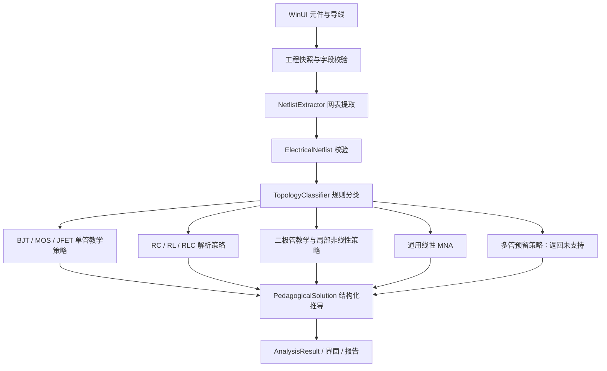
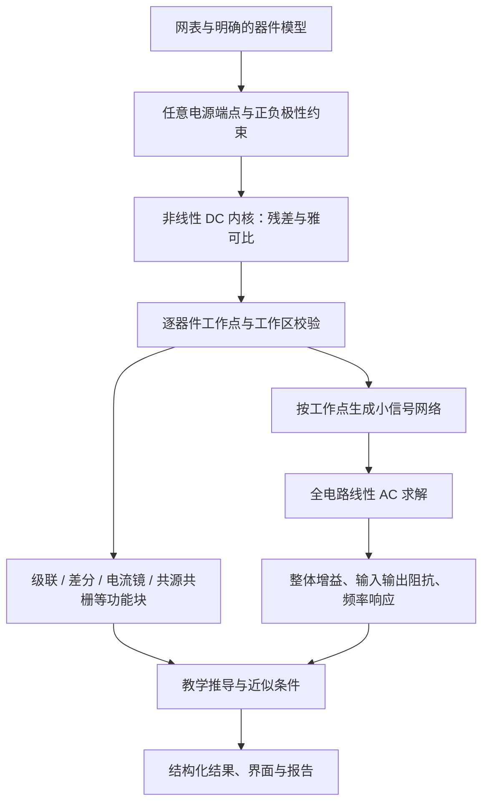

# 分析引擎实现报告：C# 网表、拓扑分类与教学求解

> 2026-10-19 工作区判定修订：保留教学中间值舍入，物理工作区独立使用未舍入解核验；BJT 的 Re=0、软分压器回退、MOS/JFET 负载线及二极管/FET 无效数值处理见[修订记录](operating-region-validation-20261019.md)。这是有限教材模型的校验改进，不代表已实现任意非线性网络或 BJT 饱和区求解。

> 更新：2026-10-19（新增当前与目标两条技术路线，补充耗尽型 MOS/JFET 现行能力；第九轮能力增量：BJT 小信号参数 r_bb'/r_be(h_ie) 从元件读取、0=自动/题目给定 r_be 直接采用、Values 新增 `rbb_ohm`/`rbe_ohm`/`rbe_source`、非法值明确失败；第八轮：BJT 信号源内阻 Rs/电解输入耦合电容/Aus、未覆盖电阻诊断、保存保留工程名、M2 测试维护；第七轮：BJT/MOS 教材估算法显示与两位小数、DC/AC 等效电路相位与 StepGroups、全部题型显示两位小数；第六轮：二极管/MOSFET 非线性教学求解、BJT 共集电极、多级预留接口）；主软件以 `apps/desktop-winui/Engine/` 当前源码为准。早期 Python/Lcapy 方案见[历史副本](archive/2026-10-17-before-winui-doc-sync/analysis-engine-technical-report.md)，不是当前 WinUI 引擎的依赖说明。


> 技术路线导航：[路线一：当前混合分析架构](#11-技术路线一当前混合分析架构已实现)；[路线二：多管与正负双电源演进](#12-技术路线二多管与正负双电源演进待实现)。这里的“两条路线”分别指当前实现和目标架构；WinUI 与 Python 是并存的代码实现，不能合并计算其能力。

## 1. 入口与执行过程

```text
AnalysisStudioViewModel.SolveCircuitAsync
  → 独立工程快照、字段校验和规模检查
  → NetlistExtractor.ExtractNetlist(Elements, Wires)
  → ElectricalNetlist.Validate → TopologyClassifier.Classify(netlist, out strategy)
  → BuildAnalysisParameters(netlist)
  → strategy.SolveAsync(netlist, parameters, cancellationToken)
  → 若非 MNA 专用策略失败：尝试 MnaLinearStrategy；仅回退成功时替换原结果
  → PedagogicalSolution.ToAnalysisResult()
  → Result / SolutionSteps / 右侧推导标签页
  → [按需] ReportExportService 从同一 netlist + solution 生成报告
```

正式分析在 .NET 进程内执行，不提交 FastAPI 任务，不需要 Python、SymPy、Lcapy 或 ngspice。`CircuitApiService.AnalyzeCircuitAsync()` 是仍保留的旧共射实现，默认访问 `127.0.0.1:8000/api/v1/analyze` 后回退固定公式；主求解按钮没有调用它。

第二轮已去掉构造/重置时的旧静态共射预览。启动为空白未求解状态；重置模板参数不会替换当前画布，模型变更会使旧结果失效。第二轮加入了协作式取消令牌、专用策略→通用 MNA 回退、最近解缓存（供报告导出）以及结构化 `LinearNetwork` 结果；当前代码对所有非 MNA 专用策略的失败都会尝试 MNA 回退；MNA 自身拒绝二极管/BJT/MOS/JFET，回退失败时保留原策略结果，因此不会把这些非线性电路当作线性网络求解。

## 2. 输入、网表与校验

输入是原生 `CircuitElement`、`CircuitWire` 集合。并查集提取真实连通网络，建立节点、二端支路和晶体管多端映射；细节见[数据层报告](data-layer-technical-report.md)。

当前校验与执行行为：

- 基于编辑状态快照在后台执行，避免提取器回写 NetId 导致用户工程误判修改。
- Validate 已接入，短路、悬空、分离网络、非法单位/数值会阻止分析；缺 GND 的自动参考选择会显示提示。
- 每个策略检查自身适用范围；不支持元件与无有效解的情形返回 IsSuccess=false 或明确异常。
- UI 根据 IsSuccess 展示结果，修订号变化时丢弃旧结果；15 秒等待上限与取消入口不会发布迟到结果。
- 等待超时/取消不等于已强制终止所有底层同步运算。规模限制为 512 个元件、4096 根导线，MNA 最多 256 个矩阵变量。

## 3. 分类规则与实际策略

| 优先级 | 条件 | 分类/子类 | 实例 |
|---|---|---|---|
| 1 | 晶体管总数（BJT + MOSFET/JFET）> 1，含 BJT+MOS 混合 | MultiStageAmplifier / Cascade | `MultiStageAmplifierStrategy`（明确拒绝，预留 `IMultiStageAnalysis`） |
| 2 | 恰一个 NPN/PNP | BjtAmplifier：CommonBase → **CommonCollector（新增）** → CollectorFeedbackBias / VoltageDividerSelfBias / FixedBias | `BjtAmplifierStrategy(subtype)` |
| 3 | 恰一个 MOSFET/JFET | MosfetAmplifier：CommonSource / CommonSourceWithSourceResistance / CommonSourceBypassed / CommonDrain / CommonGate（增强/耗尽 MOS 与 N/P JFET，含参数及工作区校验） | `MosfetAmplifierStrategy(subtype)` |
| 4 | 无晶体管且二极管 ≥ 1 | DiodeCircuit：HalfWaveRectifier / HalfWaveRectifierFiltered / BridgeRectifier / BridgeRectifierFiltered / SeriesLimiter / DoubleLimiter / Clamper / PeakDetector / DiodeBias | `DiodeCircuitStrategy(subtype)` |
| 5 | 恰一个 C 或 L | FirstOrderRc / FirstOrderRl | `FirstOrderRcStrategy` |
| 6 | 恰两个储能元件且同时有 L/C | SecondOrderRlc：SeriesRlc / ParallelRlc | `SecondOrderRlcStrategy` |
| 7 | 其余线性网络或空网络 | MnaLinear；空网络分类 Unsupported | `MnaLinearStrategy` → `LinearNetworkAnalyzer` |

RC 根据 AC/DC 源及电容接地情况细分；RLC 根据 L/C 是否共享两个网络判断串/并联。单管 BJT 检查基极旁路/接地及若干电阻连通，找不到时仍有器件编号启发式与默认子类型；共集电极判定要求集电极直接接电源轨（PNP 镜像为地轨）、发射极经 Re 有直流通路且非直接接地、基极有输入耦合或偏置网络。MOSFET 子类型只依赖连通性（不依赖元件 Id）；二极管子类型按"桥式 → 纯直流偏置 → 钳位电容 → 双向限幅 → 单管并联限幅 → 单管串联整流/检波"的顺序识别。

分类采用有限启发式，正式入口先校验连通性与参数，各策略再校验适用范围。MOS/JFET 不再落入 Unsupported，而是路由到 MOSFET 教学策略并在需要时明确拒绝；二极管电路不再进入 MNA。**`MnaLinearStrategy`/`LinearNetworkAnalyzer` 自身仍拒绝二极管/BJT/MOS/JFET/VccPort/变压器**，该负向行为第六轮未改变；专用一阶/二阶/BJT 策略拒绝时，工作台仍以同一网表回退到 MNA 2.0（直流稳态/交流相量）。

## 4. 一阶 RC/RL

`FirstOrderRcStrategy` 输出五步：等效电阻、三要素、时域解、传递函数与截止频率、波特渐近特性。无晶体管时 Q 点用破折号显示，不生成 BJT 参数推导。

当前计算方式：

- 选第一个储能元件和第一个 DC/AC 电压源。
- 仅接受一个电压源、一个储能元件与串联电阻构成的单闭合回路；先检查各节点度数和器件范围，再求和计算 Req；不再用默认器件值补缺。
- RC：`τ=Req·C`；RL：`τ=L/Req`；`fc=1/(2π·τ)`。
- 初值固定为零；RC 稳态固定取源电压，RL 稳态取 `Vs/Req`。
- RC 低通与归一化 RL 电流采用 `H(s)=1/(1+sτ)`；RC 高通输出取串联电阻总电压，采用 `H(s)=sτ/(1+sτ)`，同步调整相位/幅频说明。

适用于满足这些假设的基础教学例子。它没有先将独立源置零后对任意电阻图求端口等效，没有求开关前状态，也未处理一般加载、并联电阻或多源网络。

已修正高通仍输出低通公式，以及 RL 电流步骤出现电容电压结果的问题。任意并联/加载/多源网络依旧不支持，但现在拒绝生成超出假设的答案。

## 5. 二阶 RLC

`SecondOrderRlcStrategy` 要求各一个 R/L/C；串联单回路可用电压源激励，并联要求器件共用同两节点且可用电流源激励，复杂拓扑明确拒绝。按子类型使用标准公式：

| 量 | 串联 | 并联 |
|---|---|---|
| 固有角频率 | `ω0=1/√(LC)` | 相同 |
| 衰减 | `α=R/(2L)` | `α=1/(2RC)` |
| 品质因数 | `Q=√(L/C)/R` | `Q=R√(C/L)` |
| 特征根 | `s=-α±√(α²-ω0²)` | 相同 |
| 带宽 | `BW=f0/Q` | 相同 |

输出固有频率、阻尼/根、响应形式和带宽五步。根据判别式和相对临界容差判断欠阻尼、过阻尼或临界阻尼；并非先从任意网表推导完整二阶微分方程。

时域输出是含待定系数的通式形态，没有根据一般初值解出 A1/A2。采用标准谐振支路半功率关系 `f1=(√(BW²+4f0²)-BW)/2`、`f2=(√(BW²+4f0²)+BW)/2`，低频端使用等价稳定式。非正/非有限参数拒绝；临界阻尼改为相对容差。这里仍不是任意输出端口的完整传递函数求解。

## 6. 教学策略：单管 BJT/二极管/MOSFET 与多级预留

### 6.1 单管 BJT 放大电路（NPN / PNP，共射/共基/共集）

`BjtAmplifierStrategy` 接受**单只 NPN 或 PNP** 教学放大模型（四类偏置 + 共基极 + 共集电极；第八轮起也接受"信号源内阻 Rs + 电解输入耦合电容"的教材输入拓扑）；晶体管数 ≥2 的网络由分类器归入 `MultiStageAmplifier`，含二极管等其他非线性器件的单 BJT 网络仍在本策略中明确返回不支持：

1. 优先通过 B/C/E、VCC/GND 网络找 Rc、Re、Rb1、Rb2；通过输出耦合电容找 RL。PNP 使用镜像拓扑角色：Re 接 VCC 侧、Rc 接 GND 侧，Rb1/Rb2 与集电极反馈按基极分压/反馈识别。
2. 必需偏置识别失败、角色重叠或有未覆盖电阻支路时停止；没有外接负载时按开路处理，不按编号或默认值补出不存在的器件。耦合/旁路电容按连通性识别，电解电容按 `+/-` 引脚取网。
3. 固定、分压、集电极反馈偏置分别使用相应**教材估算公式**（显示口径）；共基极分支单独处理。输入侧支持"交流源—Rs—输入耦合电容—基极/发射极"拓扑（Rs 为信号源内阻）。
4. 计算 Q 点、rbe、中频增益、输入/输出电阻和频响估计：共射/共基形成五步结果（DC 相 1 步 + AC 相 4 步），共集 6 步（见 6.2）；含电解电容时在 DC 相追加极性核验步骤（如 B07 变体 6 步 = DC 2 + AC 4）。
5. 电解电容检查可追加正接或反接提示步骤（归入 DC 相）。

**硅/锗管压降**：所有 VBE（NPN）/VEB（PNP）计算使用元件的 `ForwardVoltageDrop`（硅管 0.7 V、锗管 0.3 V，可在参数面板选择），不再硬编码 0.7 V。二极管参数同样可选择硅/锗 VF，并已接入第六轮的二极管教学策略（恒压降模型与 Shockley 模型）。

BJT 策略分两层计算（第七轮用户口径）：

**① 显示层（教材估算法，UI 只显示这一层）**：分压偏置先按空载分压算 `U_B`，再逐步算 `I_EQ`、`I_BQ`、`I_CQ`、`U_CEQ/U_ECQ`；每个中间结果按显示单位最多两位小数（AwayFromZero）舍入，并把该显示值代入下一步（`Services/TeachingDisplay.RoundTo`）：

```text
U_B   = VCC·Rb2/(Rb1+Rb2)             → 两位小数
I_EQ  = (U_B−VBE)/Re                  // PNP 镜像用 VEB
I_BQ  = I_EQ/(1+β)                    // (1+β) 保留，不化简
I_CQ  = β·I_BQ                        // 不用 I_CQ≈I_EQ
U_CEQ = VCC−I_CQ·Rc−I_EQ·Re           // PNP 为 U_ECQ
rbe   = rbb'+(1+β)·UT/I_EQ            // 共射 rbb'=200 Ω、共基 50 Ω
Av/Ri/Ro/fL 等 AC 指标同样按显示单位舍入
```

**② 后端层（戴维南精确解，只用于诊断/测试/报告内部）**：把分压器等效为 `Vth=VCC·Rb2/(Rb1+Rb2)`、`Rth=Rb1·Rb2/(Rb1+Rb2)`（PNP 镜像），列基极回路 KVL 求精确 `IBQ`、`ICQ`、`U_CEQ`，写入 `QPointInfo.ExactIbq/ExactIcq/ExactVceq` 与第 1 步 `Values` 的 `IBQ_exact_uA/ICQ_exact_mA/UCE_exact_V/IEQ_exact_uA`；**UI 不绑定这些字段**，也不再有"戴维南 vs 教材估算"并列文案。

PNP 采用镜像符号约定：以 VEB 为导通压降、以 VEC 为管压降，IB/IC/IE 取正值并在结果文本中注明方向；输出 Q 点显示 `|U_CE|` 并在工作区/摘要标注 `PNP: U_CE = -|U_CE| (V_EC>0)`。小信号中频增益/输入输出电阻使用与 NPN 对应的镜像公式（共射负增益、共基极正增益），并用独立 KCL 手算/微变等效基准校核。

模型仍采用 VBE、rbb 和部分寄生电容的教学近似，不能视为完整器件仿真。显示/求解相关行为：

- **工作区按未舍入、计入基极负载的偏置解核验**：先检查有限数值，再检查基极正向驱动与集电结不正偏；`U_CEQ>0.2 V` 本身不足以保证放大区。无 Re 时不再除以 Re；空载分压估算失效但加载解处于放大区时，改用含负载偏置回路、保留教学舍入链。真实非放大区停止小信号推导，数值失败不解释成截止。
- rbe 使用教材估算链的 IEQ；发射极未旁路时输入电阻和增益计入反馈电阻；集电极反馈偏置使用对应输入/输出方程。
- 共基极 DC 计入基极分压负载，去掉针对教材题号强制显示的固定答案；步骤用 h 参数微变模型（`hie/hib/hfb`）。
- 共基极不再把固定 50 MHz 当作求解结果；上限频率和带宽明确显示未求解（或用模型估算并注明）。
- 共射高频仍是 Cπ/Cμ 固定模型参数的估算，指标有估算标记；尚无真实频率扫描或完整器件寄生参数拟合。
- 推导按 `SolutionPhase` 分组：DC 相（Q 点 + 电解电容极性核验）在前，AC 相（rbe、Av、Ri/Ro、频率）在后；`ToAnalysisResult()` 生成 `AnalysisResult.StepGroups`（2 组，组标题/说明见 `SolutionPhaseInfo`）。

#### 6.1.1 信号源内阻 Rs、电解输入耦合电容与 Aus（第八轮新增）

- **Rs 识别**：输入网（共射/共集为基极网，共基为发射极网）与交流源正端网之间直接跨接电容时仍识别为 C1、`Rs=0`；否则对每个跨输入网的电容，检查其远端网与交流源正端网之间**恰有一只电阻**，命中则该电阻为信号源内阻 Rs、该电容为输入耦合电容（如 `vs—R6=50 Ω—C3=47 μF 电解—基极`）。识别到的 Rs 计入"已识别电阻"，不再触发未覆盖电阻拒绝；串联多只电阻/复杂源网络不猜测，仍明确失败。
- **电解电容识别**：`CapNets(cap)` 对 `ElementType.CapacitorPolarized` 用 `+`/`-` 引脚取网（普通电容用 `"1"/"2"`），输入/输出耦合、发射极旁路与极性核验均统一使用；电解输入耦合电容识别为 C1 后，在 DC 相追加极性核验步骤。
- **源电压放大倍数**：`Aus = Av·Ri/(Rs+Ri)`（共基 `Aus = Au·ri'/(Rs+ri')`），使用显示舍入后的 Av/Au 与 Ri；步骤 3/4 的公式、代入式和结果附带 `A_us` 文案；第 1 步 `Values` 新增 `Rs_ohm`、`Aus` 稳定键；`AcParametersInfo` 新增 `HasSourceResistance`/`SourceResistance`/`SourceVoltageGain`，实时指标卡与报告导出仅在识别到 Rs 时显示两行。
- **下限截止频率**：输入时间常数 `τ1=(Rs+Ri)·C1`（无 Rs 时 `Ri·C1`），`fl1=1/(2πτ1)`；`fl2`、`fl_e` 与 `fL=√(fl1²+fl2²+fl_e²)` 不变。
- **未覆盖电阻诊断**：失败文案列出未识别电阻的元件 Id 与两端网名，并列出支持位置（Rc、Re、Rb1/Rb2、集电极反馈 RB、RL、Rs=源与输入耦合电容之间），提示简化拓扑后重试；不静默忽略。
- **回归保护**：无 Rs 时 `HasSourceResistance=false`、`SourceResistance`/`SourceVoltageGain` 为"—"、Values 不含 `Rs_ohm`/`Aus`，Av/Ri/fL 与第七轮一致。
- B07 教学变体实测（教材估算法显示）：`U_B=2.79 V → I_EQ=2.09 mA → I_BQ=20.69 μA → I_CQ=2.07 mA → U_CEQ=7.84 V`，`rbe=1.46 kΩ、Av=−34.25、Ri=1.23 kΩ、Ro=1 kΩ、Rs=50 Ω、Aus=−32.91、fL≈41.7 Hz`（`τ1=(50+1.23k)·47 μF`），fH≈1.76 MHz 为模型估算；步骤 6 步（DC 2 + AC 4）；后端精确值 `IBQ≈19.24 μA、ICQ≈1.92 mA、U_CE≈8.13 V` 仅保留不显示。

#### 6.1.2 小信号参数 r_bb'/r_be(h_ie) 可调（第九轮新增）

- **参数来源**：从 BJT 元件读取 `BjtRbb`（Ω，0=自动：共射/共集 200 Ω、共基 50 Ω）与 `BjtRbe`（Ω，0=按 Q 点计算；>0 为题目给定 r_be=h_ie）。全部 BJT 子类型（共射四类偏置、共基、共集，NPN/PNP）统一解析：

  ```text
  rbb      = BjtRbb > 0 ? BjtRbb : (CommonBase ? 50 Ω : 200 Ω)
  rbeGiven = BjtRbe > 0
  ```

- **computed 链（rbeGiven=false）**：`r_be = RoundResistance(rbb + (1+β)·U_T/I_EQ)`，仍按显示单位两位小数舍入并回代后续推导；rbe/hie 步骤 Content/Latex/Substitution/Result 使用**实际 rbb 值**（不再硬编码 200/50 Ω），文案注明"r_bb' 可由元件参数 rbb' 调节"。
- **given（rbeGiven=true）**：题目给定的 r_be/h_ie **原值直接采用**参与 Av/Ri/Ro/fL 推导，不再二次舍入；步骤文案写"题目给定/直接采用，不再用 r_bb' 公式计算；r_bb' 仅作记录"。这是与 computed"显示值回代"不同的有意设计。
- **共基**：`hie = rbeGiven ? 给定值 : RoundResistance(rbb + (1+β)U_T/I_EQ)`，`hib=hie/(1+β)`、`hfb=−β/(1+β)` 照旧。
- **步骤 Values 稳定键**：rbe/h_ie 步新增 `rbb_ohm`/`rbe_ohm`/`rbe_source`（`computed`|`given`），共基保留 `hie`。
- **非法值**：后端 `BjtRbb`/`BjtRbe` 非有限或负数 → 明确失败且文案含"必须为有限非负数（0 表示自动…）"，不抛异常、不输出 Q 点/交流参数/步骤；UI 编辑 NaN/负数自动归零。
- **默认回归**：`BjtRbb=0`/`BjtRbe=0` 时数值与第八轮完全一致（B07 等全部既有电路）；第九轮回归 `NonlinearCircuitChecks` 913/913 覆盖默认/自定义/给定三组与 CE/CB/CC、NPN/PNP、非法值。
- **验证范围**：第九轮按用户要求只做控制台回归 + 构建（含默认 Debug 重新构建），**不做 ui-capture 窗口验收**；编辑框窗口外观/交互未验收。

上述支持范围已运行针对性回归，验证覆盖见第九轮修订记录。PNP 已在第三轮支持（镜像拓扑与 VEB/VEC 符号约定，见上），BJT 共集电极在第六轮支持（见 6.2），信号源内阻 Rs/电解电容/Aus 在第八轮支持（见 6.1.1），r_bb'/r_be(h_ie) 参数可调在第九轮支持（见 6.1.2），教材估算法数值口径见 6.6；多级级联与混合管级联求解仍属于后续本体功能扩展，**按用户要求列入后续项目规划，不在当前版本实现**，但分类器已把它们统一归入 `MultiStageAmplifier/Cascade` 并明确拒绝，不再用第一只管子套用单管公式。

### 6.2 BJT 共集电极（射极跟随器，第六轮新增）

分类器对单只 BJT 在 `CommonBase` 之后、三类偏置之前判定 `CommonCollector`：集电极直接接电源轨（PNP 镜像为地轨，与电源轨之间无电阻）、发射极经 Re 有直流通路且不是直接接地（输出端）、基极有输入耦合电容或偏置电阻网络。`BjtAmplifierStrategy` 的共集分支：

- **DC 相（教材估算法）**：固定偏置 `IB=(VCC−VBE)/(Rb+(1+β)Re)`；分压偏置先按空载分压算 `U_B`、`IB=(U_B−VBE)/(Rth+(1+β)Re)`；`IE=(1+β)IB`、`VCE=VCC−IE·Re`；`rbe=rbb'+(1+β)·VT/IE`（沿用 200 Ω 共射约定）；每一步显示值两位小数舍入并回代。后端仍保留戴维南精确 Q 点（`QPointInfo.Exact*`，不显示）。
- **工作区**：`VCE≤0.2 V` 饱和失败、`IB≤0` 截止失败（与既有 BJT 策略一致）。
- **AC 相**：`Re'=Re∥RL`、`Av=(1+β)Re'/(rbe+(1+β)Re')`（正、略小于 1）、`Ri=Rb∥[rbe+(1+β)Re']`、`Ro=Re∥(rbe+Rb)/(1+β)`；另含下限截止频率估算，共 **6 步**（DC 1 + AC 5），QPoint/AcParameters 正常填写，摘要标注"射极跟随器（共集电极）"。
- **分组与回归**：`AnalysisResult.StepGroups` 为 DC/AC 两组；`tests/NonlinearCircuitChecks/BjtCcChecks`（NPN 分压与 PNP 变体手算对拍 ≤1%、教材估算链 20.1 μA/2.01 mA/9.97 V 等、与共射/共基不混淆、截止/饱和失败、6 步、多级预留接口）与 `examples/circuit-models/B10-common-collector.circuit`。
- **信号源内阻 Rs/Aus（第八轮）**：共集同样识别 `交流源—Rs—输入耦合电容—基极` 拓扑，`Aus=Av·Ri/(Rs+Ri)`，识别到 Rs 时 UI/报告显示 Rs/Aus 两行；含电解输入耦合电容时在 DC 相追加极性核验步骤；回归见 `BjtSourceResistanceChecks` 的"共集 + Rs"用例。
- **小信号参数 r_bb'/r_be(h_ie)（第九轮）**：共集与共射同形，读取 `BjtRbb`/`BjtRbe`（0=自动），computed 用 `r_be = r_bb'+(1+β)U_T/I_EQ`，given 直接采用给定 r_be；rbe 步骤文案/公式使用实际 rbb；回归见 `BjtSmallSignalParameterChecks` 的共集默认/自定义 rbb/给定 rbe 用例（默认 Ro=114.66 Ω，自定义 rbb=400 → rbe=1690 Ω，给定 rbe=1500 → Ro=114.73 Ω）。

### 6.3 二极管非线性教学策略（第六轮新增）

`Engine/Nonlinear/DiodeModel.cs` 提供两类模型：

- **分段线性恒压降模型**（大信号/波形教学）：导通压降 `VF=element.ForwardVoltageDrop`（硅 0.7 V / 锗 0.3 V），`vD≥VF` 导通、反向阻断；用于整流/滤波/限幅/钳位等解析分析。
- **Shockley 模型**（任意 R + 二极管 + 直流源的直流工作点）：`iD=Is(exp(vD/(n·Vt))−1)`，默认 `Is=1e-12 A`、`n=1`、`Vt=AnalysisParameters.ThermalVoltageUt`；指数自变量钳位到约 ±0.99 V，`Current/Conductance/Region` 可单元测试且 `Conductance` 是 `Current` 的解析导数。

`Engine/Strategies/DiodeCircuitStrategy.cs`（`TopologyType=DiodeCircuit`）支持 9 类子类型：`HalfWaveRectifier`、`HalfWaveRectifierFiltered`、`BridgeRectifier`、`BridgeRectifierFiltered`、`SeriesLimiter`、`DoubleLimiter`、`Clamper`、`PeakDetector`、`DiodeBias`。AC 源峰值取 `ValueSI`、频率取 `FrequencyHz`，恒压降输出扣除 VF；每类用教材解析公式计算 Vavg/Vrms/PIV/Vdc/Vr/门限/偏移/ID/VD 等关键量，成功解 ≥4 个推导步骤，`QPoint` 标记"二极管非线性电路"、`AcParameters` 为 null，关键指标写入 `SummaryText` 与步骤 `Values`。直流偏置（`DiodeBias`）只支持"源—电阻—二极管"单一串联回路（含并联/分支时明确拒绝并说明"并联/分支结构"）；拓扑不匹配返回含"二极管"的失败信息而不抛异常。回归：`tests/NonlinearCircuitChecks/DiodeChecks`（9 类场景手算 ≤1%、Si/Ge 差异、失败路径）、`CircuitModelChecks` D01–D07、生成器 `CircuitModels.Diode --verify` 7/7。

### 6.4 MOSFET/JFET 教学策略（2026-10-19 更新）

`Engine/Nonlinear/MosfetModel.cs` 与 `Engine/Strategies/MosfetAmplifierStrategy.cs` 支持增强型/耗尽型 NMOS、PMOS 和 N/P 沟道 JFET；通用 `Jfet` 按 N 沟道处理。五种子类型为 `CommonSource`、`CommonSourceWithSourceResistance`、`CommonSourceBypassed`、`CommonDrain`、`CommonGate`。

- MOS 的 `Vth=DisplayNumber`，增强型 N/P 为正/负，耗尽型 N/P 的 VGS(off) 为负/正；`K=MosfetK`（A/V²，默认 1 mA/V²），`λ=MosfetLambda`（1/V，0 表示忽略沟道长度调制）。N 沟道 `Vov=VGS−Vth`，P 沟道 `Vov=Vth−VGS`；Vov≤0 为截止，不能用绝对值把负过驱动变成导通。
- JFET 使用独立参数 `JfetIdss`（A），由 Shockley 方程 `ID=IDSS·(1−VGS/VGS(off))²` 得到 `K=IDSS/VGS(off)²`；缺失/非法 IDSS 明确提示补参，不采用 MOS 默认 K。
- 饱和电流为 `ID=K·Vov²·(1+λ·VdsMag)`，`gm=2K·Vov·(1+λ·VdsMag)`、`gds=λK·Vov²`。有源极电阻时，λ=0 解二次方程并排除非物理解；λ>0 使用数值求根。
- 耗尽 MOS 允许向增强方向偏置；JFET 校验舍入前的栅源偏置，N 沟道 VGS>0 / P 沟道 VGS<0 时拒绝继续按 IG≈0 推导。
- 检查器现可编辑 MOS 的 K、JFET 的 IDSS 及 λ；IDSS 已接入克隆、工程 DTO、保存加载及有效性校验。旧 JFET 工程缺省 IDSS=0，可打开编辑但求解时要求补参。

推导仍为 **DC 相 3 步 + AC 相 4 步**：栅极偏置 → 平方律/Shockley 方程求 ID → 漏源电压与饱和区校验 → gm/gds/ro → Av → Ri/Ro → 低频截止估算。中间显示量采用教材单位、两位小数舍入后回代；稳定数值键包括 `ID/VGS/VDS/gm/Av/Ri/Ro`，另有 `DeviceFamily/IDSS/VGSoff/K`。P 沟道 VDS 数值保留符号，Q 点卡片按现有 VSD/幅值约定展示。

当前仍限定单管、单一正电源和已覆盖的偏置网络。截止或可变电阻区工作点明确失败，不输出小信号增益；Av/Ri/Ro 沿用忽略 ro 的教材中频近似，低频截止为估算。信号源内阻/Aus 的专门分析、电解输入耦合电容极性核验、高频寄生和多管网络未在本次扩展中实现。

2026-10-19 已验证：非线性检查 **1534/1534**、EngineV2 **306/306**、显示舍入 **55/55**、WinUI x64 Debug 构建 **0 警告/0 错误**。这些是本会话功能实现阶段的验证记录；本次文档编辑不重复执行软件回归。新增检查覆盖五类器件（含通用 JFET）×五种拓扑、N/P 电压方向、独立手算、非法参数、正偏拒绝、λ、克隆与 JSON 往返；不代表任意拓扑或桌面交互验收。详见[耗尽 MOS/JFET 实现记录](fet-depletion-jfet-strategies-20261019.md)。

### 6.5 多级放大：只预留接口（第六轮新增）

`Engine/MultiStage/MultiStageContracts.cs` 定义预留契约：`IMultiStageAnalysis.TryPlan(netlist, out MultiStagePlan, out error)`、`MultiStagePlan`（`Stages`/`TopologyNote`/`PlannedImplementationOrder`）、`MultiStageStage`（`DeviceId`/`DeviceType`/`SubtypeHint` 等）。`Engine/Strategies/MultiStageAmplifierStrategy.cs` 的 `SolveAsync` 永不返回数值解：消息包含"多级""后续开发规划""预留"，说明当前只支持单管并提示拆分为单级，同时列出后续实现顺序（单管全类型 → 多级级联 → 二极管非线性扩展 → 混合管 → 大信号/失真）。`TryPlan` 可从 `ElectricalNetlist.Transistors` 返回各管的规划阶段，但不做级联求解。回归：`BjtCcChecks` 的多级段 + `CircuitModelChecks` 的 B12–B14 拒绝断言。

### 6.6 教材估算法数值口径（第七轮改写；原第六轮"对照"已废弃）

**用户口径**：BJT/MOSFET 的显示结果必须和学生按教材手算一致，**不是代数化简，是数值保留两位小数**——公式保留全部项（`(1+β)` 不合并、`I_CQ=β·I_BQ` 不近似为 `I_EQ`），只在每个中间结果处按显示单位最多两位小数（`MidpointRounding.AwayFromZero`）舍入，并把舍入后的显示值代入下一步。原先"戴维南精确值 vs 教材估算值"并列显示、差异百分比与适用性判据的"对照"实现已被删除（保留在[第六轮修订记录](technical-code-fixes-20261018-round6.md)作为历史）。

**显示层（`Services/TeachingDisplay.cs`）**：按 `QuantityKind` 选教材显示单位（V/mV/μV、A/mA/μA、Ω/kΩ/MΩ 等），`Format/Text/RoundTo/Plain/RoundPlain/Latex/LatexNumber` 一律 ≤2 位小数；`DisplayQuantity.Si` 暴露该显示文本对应的舍入后 SI 值供回代。分压偏置显示链：

```text
U_B   = VCC·Rb2/(Rb1+Rb2) → 舍入
I_EQ  = (U_B−VBE)/Re     → 舍入
I_BQ  = I_EQ/(1+β)       → 舍入
I_CQ  = β·I_BQ           → 舍入
U_CEQ = VCC−I_CQ·Rc−I_EQ·Re → 舍入
```

**后端层（戴维南精确解，不显示）**：`QPointInfo.ExactIbq/ExactIcq/ExactVceq` 与第 1 步 `Values` 的 `IBQ_exact_uA`/`ICQ_exact_mA`/`UCE_exact_V`/`IEQ_exact_uA`，分压偏置另有 `Vth_V`/`Rth_ohm`/`UB_actual_V`。这些字段只用于诊断、测试与报告内部计算，**不绑定 UI**；第 1 步 `Values` 中面向显示的同名键（`IBQ`/`ICQ`/`IEQ`/`VCEQ`/`UB` 等）保存舍入后回代值。摘要不再包含"戴维南/精确解/教材估算对照/11.1%"等双口径文案。

**题3-12 实测**（`document/3-6题.circuit`，PNP 分压偏置：VCC=12 V、RB1=15 kΩ、RB2=470 kΩ、RE=1.3 kΩ、RC=2 kΩ、锗管 VEB=0.3 V、β=100）：

| 量 | 显示链（教材估算法） | 后端精确值（不显示） |
|---|---|---|
| U_B | 11.63 V | 11.6289 V（Vth）；实际基极电位 ≈11.636 V |
| I_EQ | 53.85 μA | —（`IEQ_exact_uA` 保留） |
| I_BQ | 0.53 μA | 0.487767 μA |
| I_CQ | 53 μA | 0.0487767 mA |
| U_ECQ | 11.82 V | 11.8384 V |

`Rth=14536.1 Ω`。Q 点面板显示 `0.53 μA / 53 μA / 11.82 V`；显示链与摘要、第 1 步 `Values` 一致。

**软分压器核验（2026-10-19 修订）**：原 NativeBenchmark30 B08 参数（VCC=15 V、Rb1=120 kΩ、Rb2=60 kΩ、Rc=3 kΩ、Re=1 kΩ、β=80）在空载分压估算下得到 UCE≈−2.05 V；这只能说明该估算不适用。含基极负载的方程给出 IB=35.537… μA、UCE=3.59256… V，仍在放大区。当前改用含负载方程并保留教学舍入链，显示 IB=35.54 μA、IE=2.88 mA、IC=2.84 mA、UCE=3.6 V。对应回归已从“必须拒绝饱和”改为“不能把估算失效误报为实际饱和”。

**回归**：`tests/NonlinearCircuitChecks` 第七轮扩至 751/751（新增 `BjtDcAcPhaseChecks`、`TestQuantity`，重写 `BjtVdEstimateChecks`，更新 `BjtCcChecks`），**第八轮扩至 822/822**（新增 `BjtSourceResistanceChecks` 71 项：B07 变体 Rs/电解 C3/Aus/fL、无 Rs 对照、未覆盖电阻诊断、电解反接 Warning、共基/共集 + Rs），**第九轮扩至 913/913**（新增 `BjtSmallSignalParameterChecks` 91 项：默认自动/自定义 rbb/题目给定 rbe，CE/CB/CC、NPN/PNP、`rbb_ohm`/`rbe_ohm`/`rbe_source` 键、非法值）；`tests/DisplayRoundingChecks` **55/55** 扫描全部题型显示文本 ≤2 位小数；`NativeBenchmark30` **30/30（100%）**。另 `tests/CircuitModelChecks -- --file <path>` 可对任意 `.circuit`（含 B07 变体）打印全部步骤/Values 供人工对照。

## 7. 通用 MNA 2.0 线性网络分析

第二轮把原来的基础 MNA 重写为 `Engine/Linear/LinearNetworkAnalyzer.cs` + `MnaLinearStrategy` 两层：分析器只负责建立并求解线性网络，策略负责教学步骤、显示格式与结构化结果填充。

分析器以非地节点电位和支路电流为未知量，装配 `A·x=Z`，采用**行均衡 + 部分选主元的复数高斯消元**，回代后做相对残差复核；奇异/病态/非有限结果返回明确失败原因。矩阵变量上限 256。

| 能力 | 当前状态 |
|---|---|
| 电阻电导印记 | 已实现 |
| 独立 DC/AC 电压源 | 已实现；AC 相量取峰值幅值实数相量 |
| 独立 DC/AC 电流源 | 已实现；沿用旧方向约定（电流 out→in，KCL in 网 +I、out 网 −I） |
| 电容/电感 | DC：C 开路、L 0V 短路（保留电流变量）；AC：C=jωC、L=jωL |
| VCVS | 已实现：v(OUT1)−v(OUT2)=μ(v(IN1)−v(IN2))，输出支路电流变量 |
| VCCS | 已实现：I(OUT1→OUT2)=gm(v(IN1)−v(IN2)) |
| CCVS | 已实现：控制端 0V 支路电流 Ictrl=IN1→IN2；v(OUT1)−v(OUT2)=r·Ictrl |
| CCCS | 已实现：控制端 0V 支路电流 Ictrl；I(OUT1→OUT2)=β·Ictrl |
| 受控源增益单位 | “倍”/空=1、S=1、mS=1e-3、μS/uS=1e-6、Ω=1、kΩ=1e3、MΩ=1e6、mV=1e-3、kV=1e3、mA=1e-3、μA/uA=1e-6；未知单位按 ×1 处理并写入 BoundaryNote |
| 任意端口等效电阻 | 已实现：独立源置零（V 短路/I 开路）、C 开路/L 短路，A→B 注入 1A 求 (V_A−V_B)/1A；可能为 +∞ |
| 戴维南等效 | 已实现：DC 开路电压 Voc + Req；AC-only 网络可能无 DC 解 |
| 交流频响与扫频 | 已实现：10 Hz–10 MHz、每十倍频程 10 点（61 点）；−3 dB 截止用对数插值估计；输出端口为启发式；截止不可测时字段为 null 并写"未检测到（超出扫描范围）"（不输出伪值） |
| 非线性/二极管/BJT/MOS/JFET/变压器/VccPort | **未装配**，明确拒绝并列出器件 ID |
| 瞬时/暂态、互感、运放、更宽频域 | 未实现 |
| 取消 | 全部建网/求解/扫频循环响应 `CancellationToken`（协作式，不是进程级强制终止） |

因此“采用 MNA 方法”仍不能推导出“支持所有元件/SPICE 全功能”。二极管/MOSFET/BJT 不再落入 MNA 计算，而由各自的专用教学策略处理；多级网络由预留策略明确拒绝；MNA 自身对二极管/MOS/JFET/BJT/变压器的直接拒绝行为保持不变（直接调用 `LinearNetworkAnalyzer.TryCreate` 的负向测试继续有效）。

第二轮独立数值审计发现并修复了两个低严重度问题，语义已收紧：

1. **截止频率**：−3 dB 参考改为“窗口内最大增益 ∪ 窗口外探针”，扫频窗口完全处于阻带或交叉点在窗口外时，`LowerCutoffHz/UpperCutoffHz/BandwidthHz` 为 null、Display 写“未检测到（超出扫描范围）”、BoundaryNote 说明“扫频窗口未覆盖真实 −3 dB 截止频率，截止频率与带宽估计不可用”，不再返回伪截止值。
2. **激励源端口**：DC 与 AC 一致采用独立电压源优先，仅无电压源时才用电流源；同类源按元件 Id 确定性排序，不再依赖命名顺序。

`MnaLinearStrategy` 输出固定 5 步：矩阵方程、节点电位与支路电流、任意端口戴维南/诺顿表、AC 相量与频响、适用范围声明（无 AC 激励时第 4 步说明不生成频响）。同时填充 `PedagogicalSolution.LinearNetwork`：

- `NodePotentials`：所有非地网电位（DC 伏特；AC 峰值幅值，Display 含相位）；
- `PortEquivalents`：源端口、输出端口和前 12 对节点组合（最多 14 条，截断写入 BoundaryNote）；
- `FrequencyResponse`：工作频率增益/相位、截止/带宽、61 个扫频点、边界说明；
- `AcParameters`：可确定端口时填电压增益、输入/输出电阻、截止与带宽；DC 网络填 DC 电压比与等效电阻，截止写“不适用（无交流激励）”；
- `RawMnaLog`：保留旧 DC 日志格式，供旧回归与界面显示。

## 8. 结果、数学与调度

策略内部仍主要为同步计算，工作台在独立模型快照上后台调用，提供取消令牌、15 秒等待上限和规模限制；第二轮取消可作用于策略入口与 MNA 循环，但仍不保证强制终止任意第三方同步运算。512 元件/4096 导线为工作台规模上限，256 为 MNA 矩阵变量上限。

`BuildAnalysisParameters()` 现从首个交流源的 FrequencyHz 读取频率，与幅值/单位分开。温度、暂态/频响开关仍未被所有策略消费；MNA 的 AC 频率来自 AC 源或工作频率。

步骤模型保存原始 LaTeX、代入式、解释与结果；UI **不再把 LaTeX 转写为 Unicode 文本**，而是由 `Controls/MathFormulaView` 在 Win2D `CanvasControl` 上用 `Math/` 解析器与二维布局引擎绘制（真上下角标/分叠放式/根号/矩阵/自动换行，基础字号 16，内容自适应高度），复制 LaTeX 按钮保留（详见展示层报告）。数字显示统一为"最多两位小数"：新增 `Services/TeachingDisplay.cs`（教材单位 + AwayFromZero 舍入 + 回代值），`ScientificNotationFormatter` 默认 precision 由 3 改为 2 并新增 `RoundEngineering`；BJT/MOS 之外的题型（RC/RL/RLC/MNA/二极管/报告）同样按两位小数显示。极值与 NaN/Infinity 仍按原规则处理。`DisplayRoundingChecks` 扫描显示文本验证该约定。

原生结果现在包含 `LinearNetworkInfo` 结构化契约（节点电位、任意端口等效、频响与扫频点），`ToAnalysisResult()` 将其映射到 UI；但完整 DC/AC 等效 `CircuitGraph`、结构化增益表达式树、知识点标签集合仍未实现，界面也未自动绘制等效电路图。等效关系以节点/端口表和 LaTeX 报告中的 circuitikz 原理图呈现。

## 9. SPICE 文本与独立 Python 引擎

`ElectricalNetlist.ToSpiceNetlist()` 支持部分 R/C/L、独立电压源、DC 电流源、二极管与 BJT 文本。不完整覆盖 AC 电流源、FET、受控源、变压器；没有完整模型卡和分析指令，也没有仿真器调用或数值交叉校验。

保留的 Python 原型位于 `services/engine/src/`：

- 默认注册顺序是 Diode、BJT AC、BJT DC、MOS AC、MOS DC、Linear，共六个策略。
- `types.py/circuit_loader.py` 使用 dataclass 和手动加载 Web 形状 JSON；输出是另一套 AnalysisResult。
- `mna.py` 与 `solver.py` 使用 SymPy。SafeSolver 有线程等待超时、表达式项数检查及数值回退；超时返回不保证后台线程被终止。
- requirements 将 Lcapy/PySpice 列为注释可选项，实际没有调用路径。数值回退也不是调用 PySpice。

它与 WinUI C# 引擎是并存的实现，不能将双方能力合并为已交付的单一引擎。第二轮新增的 `WebCircuitGraphImporter` 只做 Web/Python → 原生的单向导入，3 个 benchmark 样例可还原拓扑；不等同于双向互通或统一结果契约。

## 10. 修改状态与后续安排

第二轮新增测试工程 `tests/EngineV2Checks`（第三轮扩至 303 项，其中 PNP/硅锗段 94 项）覆盖 DC/AC、四种受控源、动态元件 DC 行为、Req/戴维南、扫频截止、错误路径、取消与结构化结果，以及单只 NPN/PNP 四类偏置与硅/锗压降；第六轮把其中 3 处"二极管/MOS/多级一律拒绝"的端到端断言更新为新分类/策略行为，扩至 **306 项全部通过**（第七轮把 PNP/硅锗段断言改为教材估算法数值，项数不变），同时保留直接调用 MNA 的负向断言。第六轮新增 `tests/NonlinearCircuitChecks`、`tests/CircuitModelChecks`（**259/259**：29 个教学电路文件加载→分类→求解；支持 `-- --file <path>` 单文件诊断）与 4 个生成器 `--verify`（7/7、6/6、10/10、6/6）。**第七轮新增 `tests/MathFormulaChecks`（411/411：LaTeX 解析/真角标/分式/根号/矩阵/自动换行/超宽缩小，链接 `Math/*.cs` 纯 C# 源码）与 `tests/DisplayRoundingChecks`（55/55：全部题型显示文本 ≤2 位小数）；`tests/NonlinearCircuitChecks` 扩至 751/751**。**第八轮新增 `BjtSourceResistanceChecks`（71 项），`NonlinearCircuitChecks` 扩至 822/822；`M2SolverChallenger` Suite 7 改为反射 `MathRendering` 新 API 并新增保存保留工程名断言，总数 155→156/156。** **第九轮新增 `BjtSmallSignalParameterChecks`（91 项：默认自动/自定义 rbb/题目给定 rbe，CE/CB/CC、NPN/PNP、Values 稳定键、非法值），`NonlinearCircuitChecks` 扩至 913/913；`M2SolverChallenger` 新增 4 项（10.7b 默认自动/10.7c 宏同步/10.7d 修改使旧结果失效/10.8c rbb-rbe 保存读回），总数 160/160。** `NativeBenchmark30` 30/30（100%；B08 参数调整见第七轮记录）。`tests/CircuitModelChecks` **259/259**（29 个教学电路文件加载→分类→求解；默认参数不回归；支持 `-- --file <path>` 单文件诊断）。`tests/EngineAuditChecks`（1359 项）用独立参照求解器交叉验证随机网络、KCL、戴维南、相量与结构化契约，其对 MNA 拒绝非线性器件的断言保持不变。既有 ChallengerRunner/M3/Report/WebImport/Symbol 回归保持通过；4 个生成器 `--verify` 7/7、6/6、10/10、6/6。控制台回归不等于任意拓扑或完整窗口验收；**第九轮按用户要求不做 ui-capture 窗口验收**（仅控制台回归 + 构建；第七/八轮的静态截图证据不覆盖本轮新增编辑器）。

第九轮修改记录见[第九轮修订记录](technical-code-fixes-20261018-round9.md)，第八轮修改记录见[第八轮修订记录](technical-code-fixes-20261018-round8.md)，第七轮修改记录见[第七轮修订记录](technical-code-fixes-20261018-round7.md)，第六轮修改记录见[第六轮修订记录](technical-code-fixes-20261018-round6.md)。后续本体扩展包括 MOSFET 放大器信号源内阻 Rs/Aus 与小信号参数可调、多级级联求解（当前只预留 `IMultiStageAnalysis`）、NPN+PNP 混合与 BJT+MOS 混合非线性网络、正负双电源统一建模、大信号/失真分析、完整 ERC、任意拓扑正确率与外部 SPICE 数值对照、公式排版扩展与自动等效图；视觉模块仍需开发，但安排在本体完善后的阶段。


## 11. 技术路线一：当前混合分析架构（已实现）

### 11.1 架构定位与执行链路

当前引擎采用“**图形连接提取 + 规则驱动拓扑识别 + 专用教学策略 + 通用线性 MNA**”的混合架构。主客户端为 WinUI 3 / XAML / C#，正式分析在 .NET 进程内完成，不依赖远程模型或外部仿真器执行主求解。



图示为主分发链；专用策略失败后还会尝试线性 MNA，仅在 MNA 成功时采用回退结果。线性内核会拒绝非线性器件。

### 11.2 各层的职责和算法

| 层次 | 当前代码入口 | 方法与输出 |
|---|---|---|
| 调度 | `AnalysisStudioViewModel.SolveCircuitAsync` | 独立快照、后台执行、校验、取消、15 秒等待上限、工程修订号检查 |
| 连接恢复 | `NetlistExtractor.ExtractNetlist` | 并查集、引脚/端点绑定、受限制的几何接触判断；生成网、节点、支路和晶体管端口映射，转换 SI 单位 |
| 策略选择 | `TopologyClassifier.Classify` | 根据器件数量与端口连通规则识别题型；各策略再次校验适用范围 |
| 典型电路求解 | `Engine/Strategies/` | 教材近似、解析关系和少量局部数值求根；计算与教学步骤在策略内部结合 |
| 通用线性求解 | `LinearNetworkAnalyzer` | MNA 装配复数线性系统，行均衡、部分选主元高斯消元、残差复核 |
| 结果组织 | `PedagogicalSolution.ToAnalysisResult` | LaTeX、数值代入、解释、Q 点、AC 参数、结构化线性结果；供展示与报告复用 |

线性 MNA 的未知量是非地节点电压和必要的支路电流，求解 `A·x=b`。电容/电感按 DC 与 AC 模式分别装配；独立源和四类线性受控源均有对应印记。节点电位、支路电流、端口等效与频率扫描由同一线性内核计算。

### 11.3 当前数学能力与适用边界

| 对象 | 实际算法 | 边界 |
|---|---|---|
| 单管 BJT | 偏置网络、教材 VBE/β 近似、Q 点、小信号模型 | 专用拓扑；未使用统一多 BJT 非线性节点方程 |
| 单管 MOS/JFET | 平方律/Shockley 转移关系，二次方程或数值求根，小信号推导 | 第 6.4 节所列单电源、单管及饱和放大条件 |
| RC/RL | 标准一阶电路时间常数和解析关系 | 有限标准单回路，不是一般瞬态积分器 |
| RLC | 标准串/并联电路的特征根、阻尼、谐振、Q 值 | 时域为含待定常数的通式，不是任意初值暂态求解 |
| 二极管波形题型 | 恒压降/分段近似和教材解析公式 | 按识别题型处理，不是全电路时间步积分 |
| 二极管 DC | 单一串联源—电阻—二极管回路的 Shockley 方程与 Newton 迭代 | 单只二极管、单个 DC 电压源；不能据此声称已有通用非线性 MNA |
| 一般线性网络 | DC / 复数 AC MNA、端口测试源、扫频 | 不装配 BJT/MOS/JFET/二极管等非线性器件 |
| 多管电路 | 分类与 `IMultiStageAnalysis` 规划接口 | 当前返回明确失败，尚无级联、差分、电流镜等数值求解 |

当前单管教学策略把部分中间值按显示单位两位小数舍入后回代，这是现有教材手算约定；其他结构化数值结果是否保留全精度按各策略实现，不能把显示规则统一描述为所有底层矩阵计算均被舍入。

### 11.4 WinUI 原生主链路与 Python 原型

仓库还保留 Python `AnalysisPipeline`：按注册顺序选择首个 `can_handle()` 匹配的策略，并使用 SymPy 进行符号计算和对应分析。它与 C# 原生引擎的输入、分发规则、结果结构和支持范围不完全一致；WinUI 正式求解按钮直接调用 C# 策略，没有经由该 Python 流水线。

因此，当前路线的正式表述为：

> 本系统基于电路网表和拓扑规则选择分析方法，以专用解析/数值教学策略处理典型电路，以通用 MNA 处理一般线性网络，输出结构化推导和分析结果。已实现部分局部非线性计算，尚未建立统一多器件非线性求解内核。

## 12. 技术路线二：多管与正负双电源演进（待实现）

> 本节是后续实施方案，不代表现有源码已经具备这些能力。本次仅更新技术文档，不修改引擎代码；实施阶段与验收电路是建议的开发顺序，不是完成清单。现有线性 MNA 已按电压源两端约束建模；双电源扩展的重点是晶体管教学策略、电源轨识别与通用非线性内核。

### 12.1 目标架构

目标为“**统一非线性 DC 求解 → 工作点线性化 → 全电路 AC 求解 → 功能块识别与教学推导**”。保留现有专用教学策略作为教材手算法、初值候选和回归参照；增加统一求解结果，使教学推导可以核对全电路耦合与负载。



数值求解不以识别出某种教材题型为前提。已识别的功能块可输出对应教材推导；模型可计算但缺少教学模板时，展示节点方程和数值结果，并注明推导方式。

### 12.2 电源与节点电位的通用表示

独立电压源统一使用 `V(pos)−V(neg)=Vs`。以 ±12 V 为例：`V(P)−V(0)=12`、`V(0)−V(N)=12`，因此 `V(P)=+12 V`、`V(N)=−12 V`。不把负电源节点当作地，也不默认所有源的负端相连。

`VCC/VEE/VDD/VSS` 是显示与拓扑语义，实际节点电位由连接和源约束决定。器件端电压统一取节点电位差；移除“全电路只有一个正 VCC”“发射极/源极回路只能返回地”的假设。诊断需区分浮置网络、矛盾电压源约束和冗余理想约束；矩阵奇异不等于物理电路必定无解。

第一阶段先验证双电源单管，暂不把多管复杂性与电源极性改动叠加。

### 12.3 器件接口与非线性工作点

建议新增 `NonlinearNetworkAnalyzer`、非线性器件接口及装配上下文（名称为方案，不是现有类型）。器件提供端口电流、端电压导数、工作区/适用性检查和小信号参数；电流与导数按统一端口方向装配。

未知量 `x` 包括非地节点电压和必要的支路电流，统一建立：

```text
F(x) = 0
J(x_k) · Δx = −F(x_k)
x_(k+1) = x_k + α·Δx
```

`F` 包含 KCL 与源约束，`J` 是雅可比，`α` 是阻尼系数。MOS/JFET 从已有模型继续扩展多端口电流与导数；BJT 需要增加覆盖相关工作区的连续模型，例如简化 Ebers–Moll。二极管也通过器件接口接入全电路，而非复用当前单串联回路 Newton 作为通用网络求解器。

明确区分两种模型模式：教材近似模式采用 VBE 常数、给定 β 等假设；连续模型模式采用对应大信号方程。结果、推导和外部对照必须注明模型模式与参数，避免用连续模型计算却展示成另一组近似方程。

### 12.4 收敛策略与数值正确性

- 阻尼 Newton、器件电压步长限制及合理初值；已有教学解可作初值候选，不能代替最终残差校验。
- 电源步进与 Gmin 步进作为收敛辅助；辅助项逐步退出后，重新检查原始电路方程。
- 电压和电流分别设置绝对/相对容差，同时检查变量更新量与方程残差；不能只以“变化很小”判断收敛。
- 输出不收敛、奇异/病态、非有限值、模型越界等诊断；若辅助项尚未退出或存在多个工作点，记录其影响，不生成虚假的唯一成功结论。
- 继承取消令牌与规模限制；保持全精度计算，在展示层舍入。

参考 [ngspice 官方手册](https://ngspice.sourceforge.io/docs/ngspice-manual.pdf) 的工作点与收敛辅助方法。参考其流程不等于已经集成该仿真器。

### 12.5 工作点线性化与全电路 AC

在每只器件的实际 DC 工作点上求导，生成 BJT 的 gm/rπ/ro、MOS/JFET 的 gm/gds 等；按需求扩展体效应和寄生参数。统一装配小信号电导、受控源及复数阻抗，复用/扩展现有线性 MNA 的矩阵装配和求解能力。

输入输出阻抗通过指定端口测试源计算，求输出阻抗时按定义置零独立信号激励，保留小信号受控源。差分题目需明确差模/共模输入和单端/双端输出；例如双端差模增益为 `(vo1−vo2)/(vi1−vi2)`，不能与单端增益混用。

全电路 AC 必须计入级间加载、有限 ro 和已纳入模型的反馈。仅在级联关系适用、各级按实际连接和负载定义时，使用 `Av_total=Av1_loaded·Av2_loaded`；独立单管空载增益相乘不作为一般多管算法。频率响应纳入电容/电感后通过 AC 扫频求得，不把当前耦合电容时间常数估算当成完整频响。

### 12.6 功能块识别、结果契约与教学模式

“多管”不等于“多级”。当前“一只管对应一个规划阶段”的 `MultiStageStage` 需要演进为可包含多只管子的功能块：RC 耦合/直接耦合级联、差分对、电流镜、共射共基/共源共栅、推挽、反馈网络。全电路先求解，再按识别结构解释耦合关系与近似。

结果契约需要补充节点/支路结果、按 DeviceId 索引的工作点集合、功能块及器件集合、输入输出端口、模型模式、精度约定和收敛诊断；迁移期保留单管 `QPoint` 兼容展示，不能让多管界面只显示第一只管子。

内核全精度与现有教材逐步舍入分开处理。若保留逐步舍入模式，应独立标明该手算链与全精度结果的差异，不能让两位小数显示值进入 Newton 收敛计算。

### 12.7 分阶段交付与验收

| 阶段 | 交付内容（均待实现） | 主要验收电路/条件 |
|---|---|---|
| 1 | 晶体管分析中的通用电源约束与双电源单管 | 双电源 BJT 跟随器、MOS/JFET 偏置；负轨方向、非对称电源、浮置/矛盾约束 |
| 2 | 统一非线性 DC 内核、逐管 Q 点与诊断 | 单管回归、两管直接耦合偏置、工作区切换、KCL/源约束残差、收敛失败 |
| 3 | 全电路小信号与级间负载 | 两级 RC 耦合、直接耦合、BJT+FET 混合级联；增益与端口阻抗 |
| 4 | 功能块及教材推导 | 电流镜、共源共栅/共射共基、双电源差分对；差模/共模和单/双端定义 |
| 5 | 更复杂反馈、频率响应，随后扩展大信号 | 全局反馈、推挽偏置、AC 扫频；大信号瞬态需另行建设时间步积分器 |

验收同时使用三类证据：独立教材手算、原电路 KCL/KVL/源约束与模型方程残差、同模型同参数下的外部仿真对照。另覆盖 N/P 镜像、器件重命名和网表排列变化、负电源和多个电源、截止/饱和/可变电阻区、近临界偏置及不收敛诊断。测试通过只说明对应覆盖，不替代实际教材拓扑重建与方向核对。

外部对照优先以 ngspice 为基准，先补齐导出所需模型卡、器件参数与分析指令，再调用仿真器。教材 VBE 常数/β 模式不能直接用默认 SPICE 模型参数做严格数值等价断言；需对齐模型，或分别核验教材近似与连续模型的误差来源。

### 12.8 推荐技术选择与本次状态

主线采用 C# 原生非线性 MNA 内核，复用现有线性能力与工程/展示契约；保留教学策略，逐步补充功能块推导；ngspice 初期用作外部验证基准。Python/SymPy 继续作为独立原型，不把两套实现自动视为统一引擎，也不默认引入 Python 作为桌面运行时依赖。

截至 2026-10-19，路线一以现有源码为实现依据；路线二为本次记录的演进方案，尚未实现统一非线性内核、多管数值求解或晶体管双电源通用教学分析。未来实现后应按阶段回写状态、验证日期、模型边界和具体证据。
